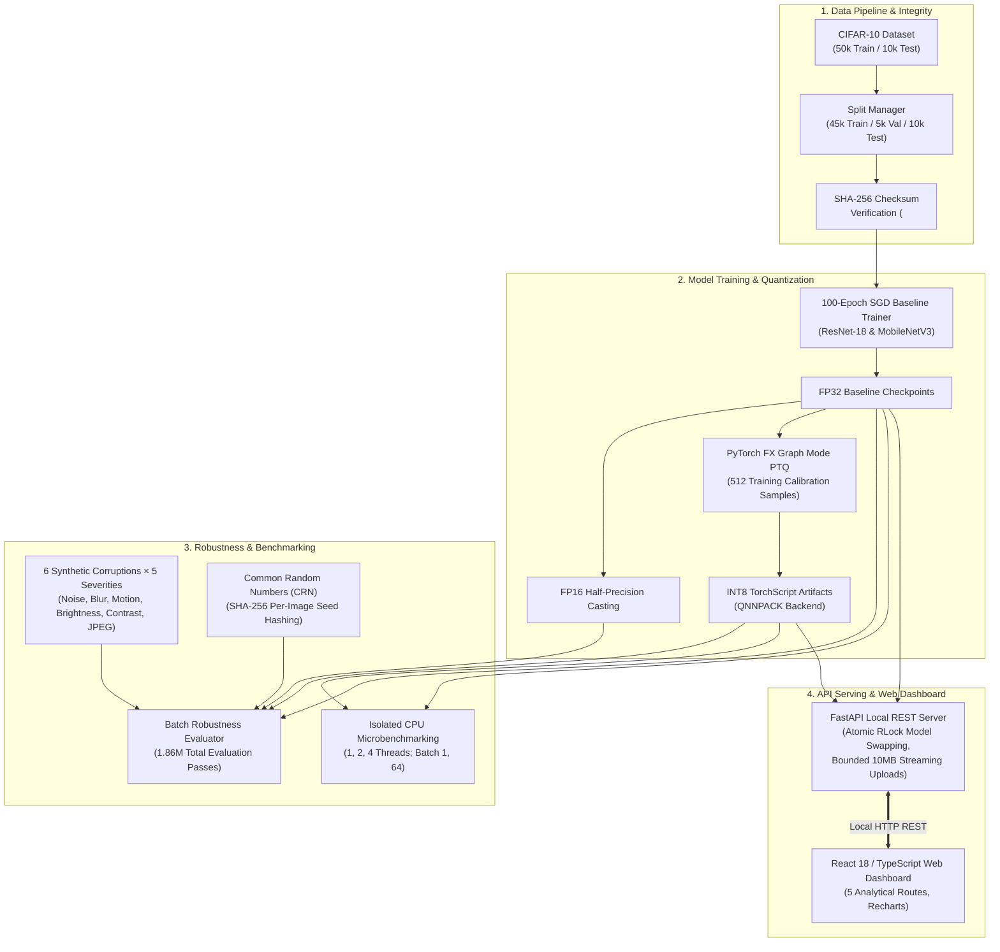

# Edge Vision Reliability Lab

**Investigating the trade-offs between model compression, inference efficiency, and predictive reliability under image corruption.**

---

## 1. Project Overview

Edge Vision Reliability Lab is an empirical machine learning systems research platform investigating how model compression affects the predictive robustness and inference efficiency of computer vision models under controlled image degradation.

In resource-constrained edge computing environments—such as drones, embedded robotics, mobile cameras, and internet-of-things (IoT) devices—computer vision models must operate within strict memory, latency, and power budgets. Post-training 8-bit integer quantization is commonly applied to reduce model size and accelerate execution. However, edge devices frequently capture images in challenging physical environments where optical blur, sensor noise, underexposure, and compression artifacts degrade image quality.

This project measures the empirical trade-offs between model size, inference latency, compute hardware, and predictive accuracy across clean and corrupted conditions.

> **Scope Note:** This repository is an empirical research and portfolio project conducted on CIFAR-10 at $32 \times 32$ resolution. It is a controlled experimental study, not a field-deployed production edge system.

---

## 2. Plain-English Summary

### What Problem Are We Studying?
Computer vision models are typically trained on clear, curated images. In real-world environments, images captured by physical cameras are often degraded by motion blur, electronic noise, low lighting, or lossy digital compression. Deploying models to resource-constrained devices also requires model compression. This project investigates whether shrinking a vision model changes its vulnerability when image quality degrades.

### What Models Are Being Compared?
We compare two convolutional neural network (CNN) architectures with distinct design trade-offs:
1. **ResNet-18:** A canonical residual network with 11.17 million parameters, representing parameter-dense convolutional baselines.
2. **MobileNetV3-Small:** A compact network with 1.53 million parameters, designed for mobile and edge execution using depthwise separable convolutions and squeeze-and-excitation modules.

### What Does Compression Mean Here?
Each model is evaluated across three numerical precision formats:
- **FP32 (32-bit floating point):** The full-precision baseline.
- **FP16 (16-bit half precision):** Halves parameter storage, evaluated on Apple Silicon GPU (MPS).
- **INT8 (8-bit integer):** Post-training static quantization using PyTorch FX Graph Mode and the QNNPACK engine on CPU, reducing parameter weights to 8-bit integers.

### What Happens When Images Are Degraded?
Each model is evaluated against 6 synthetic corruption types across 5 progressive severity levels (30 corrupted conditions total, plus clean baseline testing). Across 6 model configurations, this comprises **1,800,000 corrupted evaluation passes** and **60,000 clean baseline passes** (1,860,000 total evaluation passes over 10,000 held-out test images).

### What Did the Experiments Reveal?
- **Quantization preserved corruption stability:** INT8 post-training quantization reduced serialized file sizes by 74.77% on ResNet-18 and 68.92% on MobileNetV3-Small, while maintaining mean corrupted accuracy within $\pm 0.2\text{ percentage points}$ of full-precision FP32 models.
- **Smaller files did not guarantee faster single-thread CPU inference:** On Apple Silicon M3 CPU running a single intra-op thread, ResNet-18 INT8 recorded a batch-1 mean latency of 10.89 ms compared to 4.88 ms for Eager FP32. INT8 achieved speedups at batch size 64 across 4 threads (186.97 ms vs 295.12 ms), while MobileNetV3-Small INT8 achieved lower latency across all evaluated batch sizes (0.42 ms at batch 1).
- **Vulnerability depended on corruption type:** Gaussian noise and horizontal motion blur produced the largest average accuracy degradation across both architectures, whereas brightness darkening caused minimal accuracy loss.

---

## 3. Key Findings

1. **Clean Test Accuracy Baseline:**
   ResNet-18 FP32 achieved **94.78%** clean test accuracy on CIFAR-10. MobileNetV3-Small FP32 achieved **86.51%** clean test accuracy under the same 100-epoch training recipe.
2. **Substantial Artifact Size Reduction:**
   INT8 quantization reduced ResNet-18 artifact size from **44.78 MB to 11.30 MB** (74.77% reduction; 3.96× compression) and MobileNetV3-Small from **6.25 MB to 1.94 MB** (68.92% reduction; 3.22× compression).
3. **Robustness Parity Across Precisions:**
   Under 30 corrupted evaluation conditions, mean corrupted accuracy was nearly identical across precisions:
   - ResNet-18: FP32 = **65.73%**, FP16 = **65.73%**, INT8 = **65.76%**
   - MobileNetV3-Small: FP32 = **58.83%**, FP16 = **58.82%**, INT8 = **59.01%**
4. **Workload-Dependent Latency Scaling:**
   Compression did not yield a universal latency improvement across all workloads. At batch size 1 on a single CPU thread, ResNet-18 INT8 was slower than Eager FP32 (10.89 ms vs 4.88 ms mean latency). At batch size 64 with 4 threads, INT8 was faster (186.97 ms vs 295.12 ms). MobileNetV3-Small INT8 was faster across all batch sizes (0.42 ms at batch 1 on 1 thread).
5. **Corruption Sensitivity Hierarchy:**
   Averaged across all five severity levels, **Gaussian noise** and **horizontal motion blur** caused the largest mean accuracy degradation (reducing average accuracy below 48% on ResNet-18 and below 43% on MobileNetV3-Small).
6. **Worst Individual Conditions:**
   For individual severity-5 perturbations, the lowest observed accuracies were:
   - ResNet-18 FP32: Gaussian Noise Severity 5 (**22.79%**)
   - ResNet-18 FP16: Gaussian Noise Severity 5 (**22.81%**)
   - ResNet-18 INT8: Contrast Severity 5 (**23.80%**)
   - MobileNetV3-Small FP32: Contrast Severity 5 (**20.50%**)
   - MobileNetV3-Small FP16: Contrast Severity 5 (**20.48%**)
   - MobileNetV3-Small INT8: Contrast Severity 5 (**19.81%**)

---

## 4. Research Question & Scope

### Central Research Question
> *"How much can we compress a computer vision model before it becomes unreliable under realistic image degradation, and what trade-offs exist between model size, inference latency, resource consumption, and predictive reliability?"*

### Experimental Scope
- **Task:** 10-class image classification on CIFAR-10.
- **Input Resolution:** $32 \times 32 \times 3$ RGB images.
- **Model Architectures:** ResNet-18 (parameter-dense residual baseline) and MobileNetV3-Small (FLOP-efficient inverted residual baseline).
- **Numerical Precisions:** FP32 (eager baseline), FP16 (half precision), and INT8 (post-training static quantization).
- **Perturbations:** 6 synthetic corruption operations across 5 discrete severity levels (30 corrupted conditions).
- **Evaluation Platform:** Apple Silicon M3 (ARM64 CPU and Metal Performance Shaders GPU). INT8 execution is supported on CPU through QNNPACK.

---

## 5. Experimental Methodology

### 5.1 Dataset Partitioning & Integrity
- **Base Dataset:** CIFAR-10 (60,000 images total; 50,000 in official train set, 10,000 in official test set).
- **Partitioning:** The 50,000-image training set was partitioned into:
  - **Training Split:** 45,000 images (90%)
  - **Validation Split:** 5,000 images (10%)
  - **Test Split:** 10,000 images (canonical held-out CIFAR-10 test set, untouched during training)
- **Split Invariants:** Generated using an unstratified random permutation (`torch.randperm`, seed 42). Split index integrity is verified via SHA-256 checksums computed on little-endian unsigned 32-bit integer index arrays (`struct.pack("<I", *indices)`), recorded in `configs/cifar10_split_manifest.json`.
- **Test-Set Isolation:** The `Trainer` class explicitly validates that dataset containers containing test data cannot be supplied during training (`trainer.py#L39`). Best checkpoints were selected strictly by validation set accuracy.

### 5.2 Model Adaptations for 32×32 Imagery
Standard ImageNet backbones downsample $224 \times 224$ images by $32\times$, collapsing $32 \times 32$ CIFAR-10 inputs to single-pixel feature maps:
- **ResNet-18 Adaptation (`resnet18_cifar`):** The initial $7 \times 7$ conv (stride 2) was replaced with a $3 \times 3$ conv (stride 1, padding 1, no bias), the initial max-pooling layer was replaced with `nn.Identity()`, and the final fully connected layer was adapted to 10 classes. Total parameters: 11,173,962.
- **MobileNetV3-Small Adaptation (`mobilenet_v3_small_cifar`):** In standard MobileNetV3-Small on $32 \times 32$ inputs, five stride-2 stages downsample spatial dimensions by $32\times$, collapsing feature maps to $1 \times 1$ at stage 9 (`features[9]`), where depthwise convolution outputs tensor shape $[N, 288, 1, 1]$ into `BatchNorm2d(288)`. At batch size $N=1$ in training mode, $N \times H \times W = 1$, causing PyTorch `BatchNorm2d` to fail (requiring $>1$ sample per channel for variance calculation). Setting stem stride to 1 (`features[0][0].stride = (1, 1)`) limits total spatial reduction to $16\times$, maintaining $2 \times 2$ resolution at stage 9 ($[N, 288, 2, 2]$ input to `BatchNorm2d`, providing $N \times H \times W = 4$ samples per channel at $N=1$). Classification projection (`classifier[3]`) is adapted to 10 classes. Total parameters: 1,528,106.

### 5.3 Baseline Training Setup
Both models were trained from scratch for 100 epochs under identical hyperparameters (`configs/train_baseline.yaml`):
- **Optimizer:** Stochastic Gradient Descent (SGD) with momentum 0.9, weight decay $5 \times 10^{-4}$.
- **Learning Rate Schedule:** Initial learning rate 0.05 with `CosineAnnealingLR` ($T_{\max}=100$, $\eta_{\min}=10^{-4}$).
- **Batch Size:** 64, with training shuffle enabled.
- **Data Augmentation:** Random crop ($32 \times 32$, padding 4) and random horizontal flip ($p=0.5$). Normalization: mean `[0.4914, 0.4822, 0.4465]`, std `[0.2470, 0.2435, 0.2616]`.

### 5.4 Quantization Pipeline
- **FP16 Half Precision:** Model parameter weights were cast to 16-bit half precision using `.half()`. Inference was evaluated on Apple Silicon MPS.
- **INT8 Post-Training Quantization (PTQ):** Implemented using PyTorch FX Graph Mode quantization (`torch.ao.quantization.quantize_fx`) targeting the `qnnpack` backend.
- **Calibration Split:** Observers were calibrated on **512 clean, unaugmented training images** sampled deterministically from the 45,000-image training split (seed 42). The validation and test splits were completely excluded.
- **MobileNetV3 Skip-Connection Handling:** In MobileNetV3 inverted residual blocks, summing skip features with activations produced scale factor ratios exceeding QNNPACK's minimum threshold ($\Delta_{\text{in}} / \Delta_{\text{out}} < 2^{-14}$), causing runtime kernel assertion failures. In `src/edge_vision/quantization/ptq.py#L105-L108`, `torch.add`, `operator.add`, and `operator.iadd` were excluded from quantization (`qconfig_mapping.set_object_type(torch.add, None)`), preserving residual additions in FP32 while quantizing all convolutional and linear layers to INT8.
- **Deployment Tracing:** Converted FX graph modules were traced into standalone TorchScript artifacts (`.pt`) accompanied by structured JSON operator manifests.

### 5.5 Synthetic Corruption Suite
The corruption suite implements 6 synthetic image operations across 5 discrete severity levels (`configs/corruptions.yaml`):
1. **Gaussian Noise:** Additive zero-mean Gaussian noise ($\sigma \in [0.04, 0.06, 0.08, 0.10, 0.12]$).
2. **Gaussian Blur:** Spatial Gaussian blur filter ($\sigma \in [0.3, 0.5, 0.7, 0.9, 1.1]$).
3. **Horizontal Motion Blur:** 1D horizontal linear convolution kernel ($\text{kernel length} \in [3, 5, 7, 9, 11]$).
4. **Brightness Darkening:** Multiplicative intensity attenuation factors ($[0.90, 0.75, 0.60, 0.45, 0.30]$).
5. **Contrast Attenuation:** Linear contrast attenuation factors relative to spatial mean ($[0.80, 0.60, 0.40, 0.20, 0.10]$).
6. **JPEG Compression:** Lossy JPEG encoding quality factors ($[80, 60, 40, 20, 10]$).

> **Methodology Boundary:** This is a **custom six-corruption evaluation suite**, not the official 15-corruption CIFAR-10-C benchmark (Hendrycks & Dietterich, 2019). Reported degradation metrics measure relative degradation against each model's own clean baseline, not AlexNet-normalized mean Corruption Error (mCE).

- **Common Random Numbers (CRN) Mode:** For stochastic Gaussian noise, `derive_deterministic_seed()` (`src/edge_vision/corruptions/deterministic.py`) generates a 64-bit unsigned integer seed from a SHA-256 digest of `seed:sample_idx:corruption_name` (independent of severity). A base standard normal noise realization $\mathcal{N}(0, 1)$ is sampled once and scaled by the severity standard deviation, ensuring that spatial noise realization remains identical across severities 1 through 5 for any given image.

---

## 6. Experimental Results

### 6.1 Clean Test Accuracy & Model Size

| Model Architecture | Precision | Parameters | Disk Artifact Size | Byte Reduction vs FP32 | Clean Test Accuracy (10,000 samples) | Test Loss | Prediction Concordance vs FP32 |
| :--- | :---: | :---: | :---: | :---: | :---: | :---: | :---: |
| **ResNet-18** | FP32 | 11,173,962 | 44,775,947 B | Baseline (0.00%) | **94.78%** | 0.2003 | Baseline (100.0%) |
| **ResNet-18** | FP16 | 11,173,962 | 22,408,843 B | **49.95%** | **94.78%** | 0.2003 | 99.99% (9,999 / 10,000) |
| **ResNet-18** | INT8 | 11,173,962 | 11,296,669 B | **74.77%** | **94.81%** | 0.2003 | 99.64% (9,964 / 10,000) |
| **MobileNetV3-Small** | FP32 | 1,528,106 | 6,249,979 B | Baseline (0.00%) | **86.51%** | 0.3896 | Baseline (100.0%) |
| **MobileNetV3-Small** | FP16 | 1,528,106 | 3,169,467 B | **49.29%** | **86.49%** | 0.3896 | 99.94% (9,994 / 10,000) |
| **MobileNetV3-Small** | INT8 | 1,528,106 | 1,942,499 B | **68.92%** | **86.18%** | 0.3957 | 95.47% (9,547 / 10,000) |

*Notes on Serialization:* Artifact sizes represent exact `.pt` file sizes on disk. Decimal MB equivalents: ResNet FP32 = 44.78 MB, FP16 = 22.41 MB, INT8 = 11.30 MB; MobileNet FP32 = 6.25 MB, FP16 = 3.17 MB, INT8 = 1.94 MB. Binary MiB equivalents: ResNet FP32 = 42.70 MiB, FP16 = 21.37 MiB, INT8 = 10.77 MiB; MobileNet FP32 = 5.96 MiB, FP16 = 3.02 MiB, INT8 = 1.85 MiB.

### 6.2 Robustness Across Precisions

Evaluated across the complete held-out test partition (10,000 images per condition; 30 corrupted conditions = 300,000 evaluations per model configuration; 1,800,000 corrupted evaluations across all 6 configurations):

| Model Architecture & Precision | Clean Accuracy | Mean Corrupted Accuracy (30 conditions) | Absolute Drop ($\Delta_{\text{pp}}$) | Relative Degradation | Lowest Accuracy Condition | Worst Condition Accuracy | Second Lowest Condition | Second Worst Accuracy |
| :--- | :---: | :---: | :---: | :---: | :--- | :---: | :--- | :---: |
| **ResNet-18 FP32** | 94.78% | 65.73% | 29.05 pp | 30.65% | Gaussian Noise S5 | **22.79%** | Contrast S5 | 24.18% |
| **ResNet-18 FP16** | 94.78% | 65.73% | 29.05 pp | 30.65% | Gaussian Noise S5 | **22.81%** | Contrast S5 | 24.18% |
| **ResNet-18 INT8** | 94.81% | 65.76% | 29.05 pp | 30.64% | Contrast S5 | **23.80%** | Gaussian Noise S5 | 24.03% |
| **MobileNetV3-Small FP32** | 86.51% | 58.83% | 27.68 pp | 32.00% | Contrast S5 | **20.50%** | Gaussian Noise S5 | 21.44% |
| **MobileNetV3-Small FP16** | 86.49% | 58.82% | 27.67 pp | 32.01% | Contrast S5 | **20.48%** | Gaussian Noise S5 | 21.49% |
| **MobileNetV3-Small INT8** | 86.18% | 59.01% | 27.17 pp | 31.52% | Contrast S5 | **19.81%** | Gaussian Noise S5 | 21.19% |

### 6.3 Metric Definitions
- **Clean Accuracy ($\text{Acc}_{\text{clean}}$):** Accuracy on the uncorrupted CIFAR-10 test set ($N=10,000$).
- **Mean Corrupted Accuracy ($\overline{\text{Acc}}_{\text{corrupt}}$):** Unweighted arithmetic mean accuracy across all 30 corrupted evaluation conditions:
  $$\overline{\text{Acc}}_{\text{corrupt}} = \frac{1}{30} \sum_{c=1}^{6} \sum_{s=1}^{5} \text{Acc}_{c, s}$$
- **Absolute Accuracy Drop ($\Delta_{\text{pp}}$):** Arithmetic difference in percentage points:
  $$\Delta_{\text{pp}} = \text{Acc}_{\text{clean}} - \overline{\text{Acc}}_{\text{corrupt}}$$
- **Relative Accuracy Degradation:** Proportional accuracy decline relative to clean accuracy:
  $$\text{Relative Degradation} = \frac{\text{Acc}_{\text{clean}} - \overline{\text{Acc}}_{\text{corrupt}}}{\text{Acc}_{\text{clean}}}$$

### 6.4 Per-Corruption Mean Accuracy Hierarchy

Averaged across all 5 severity levels for each corruption type (FP32 baseline):

| Corruption Type | ResNet-18 FP32 Mean Acc | ResNet-18 Drop vs Clean | MobileNetV3 FP32 Mean Acc | MobileNetV3 Drop vs Clean |
| :--- | :---: | :---: | :---: | :---: |
| **Brightness Darkening** | **90.66%** | 4.12 pp | **76.68%** | 9.83 pp |
| **Contrast Attenuation** | **72.06%** | 22.72 pp | **56.49%** | 30.02 pp |
| **Gaussian Blur** | **71.11%** | 23.67 pp | **66.12%** | 20.39 pp |
| **JPEG Compression** | **67.83%** | 26.95 pp | **69.66%** | 16.85 pp |
| **Horizontal Motion Blur** | **47.27%** | 47.51 pp | **41.47%** | 45.04 pp |
| **Gaussian Noise** | **45.46%** | 49.32 pp | **42.54%** | 43.97 pp |

*Observation:* While individual severity-5 contrast reduction produced the lowest individual test accuracy on MobileNetV3-Small (20.50%), **Gaussian noise** and **horizontal motion blur** produced the largest average degradation across severities 1 through 5, dropping average accuracy below 48% on ResNet-18 and below 43% on MobileNetV3-Small.

---

## 7. Inference Benchmarking

The repository contains two distinct benchmarking suites with different measurement boundaries and objectives.

### 7.1 Protocol 1: End-to-End Engine Benchmark (`scripts/benchmark_inference.py`)
- **Objective:** Measure total wall-clock execution time for complete inference serving.
- **Timing Boundary:** Includes batch tensor allocation, channel normalization, host-to-device transfer, model forward pass, softmax computation, and top-$k$ prediction formatting.
- **Configuration:** 5 untimed warmup iterations followed by 20 timed repetitions across batch sizes `[1, 8, 32, 64]`. Evaluated on CPU and Apple Silicon MPS.
- **Synchronization:** Explicit `torch.mps.synchronize()` is executed after every warmup and timed iteration when benchmarking on MPS.

### 7.2 Protocol 2: Isolated CPU Microbenchmark (`scripts/benchmark_cpu_inference.py`)
- **Objective:** Measure isolated forward-pass execution time on CPU across specific thread allocations.
- **Process Isolation:** Each configuration is executed in an isolated child OS process to prevent thread-pool state retention across benchmark configurations.
- **Timing Boundary:** Strictly measures `_ = model(input_tensor)` using pre-allocated contiguous tensors (excluding preprocessing, tensor decoding, and postprocessing).
- **Configuration:** Evaluates thread counts `[1, 2, 4]` and batch sizes `[1, 64]` across Eager FP32, TorchScript FP32, and TorchScript INT8 (QNNPACK). Timed iterations: 100 runs for batch size 1 (20 warmup); 30 runs for batch size 64 (10 warmup). Two independent process repetitions per configuration.

### 7.3 Measured CPU Forward-Pass Latency & Throughput

Results from `reports/experiment_results/cpu_inference_benchmark.json` on Apple Silicon M3 CPU:

| Model Architecture | Execution Variant | Batch Size | 1 Thread Mean Latency | 1 Thread Mean Throughput | 4 Threads Mean Latency | 4 Threads Mean Throughput |
| :--- | :--- | :---: | :---: | :---: | :---: | :---: |
| **ResNet-18** | Eager FP32 | 1 | 4.88 ms | 204.8 fps | 3.79 ms | 263.7 fps |
| **ResNet-18** | Eager FP32 | 64 | 720.64 ms | 88.8 fps | 295.12 ms | 216.8 fps |
| **ResNet-18** | TorchScript FP32 | 1 | 4.40 ms | 227.1 fps | 3.48 ms | 287.6 fps |
| **ResNet-18** | TorchScript FP32 | 64 | 715.19 ms | 89.5 fps | 295.06 ms | 216.9 fps |
| **ResNet-18** | TorchScript INT8 | 1 | **10.89 ms** | **91.8 fps** | **3.08 ms** | **324.3 fps** |
| **ResNet-18** | TorchScript INT8 | 64 | **695.09 ms** | **92.1 fps** | **186.97 ms** | **342.3 fps** |
| **MobileNetV3-Small** | Eager FP32 | 1 | 4.08 ms | 245.4 fps | 23.80 ms | 42.0 fps |
| **MobileNetV3-Small** | Eager FP32 | 64 | 335.59 ms | 190.7 fps | 263.02 ms | 243.3 fps |
| **MobileNetV3-Small** | TorchScript FP32 | 1 | 3.78 ms | 264.5 fps | 23.47 ms | 42.7 fps |
| **MobileNetV3-Small** | TorchScript FP32 | 64 | 335.78 ms | 190.6 fps | 261.49 ms | 244.8 fps |
| **MobileNetV3-Small** | TorchScript INT8 | 1 | **0.42 ms** | **2,404.3 fps** | **0.48 ms** | **2,093.0 fps** |
| **MobileNetV3-Small** | TorchScript INT8 | 64 | **17.31 ms** | **3,699.4 fps** | **5.48 ms** | **11,672.4 fps** |

### 7.4 Latency Observations
- **ResNet-18 Batch-1 Single-Thread INT8 Slower:** On 1 thread at batch size 1, ResNet-18 INT8 recorded higher mean latency than Eager FP32 (10.89 ms vs 4.88 ms). At batch size 64 across 4 threads, INT8 recorded lower latency than FP32 (186.97 ms vs 295.12 ms). Determining the precise hardware causes for this trade-off would require cache and profiling measurements beyond this study.
- **MobileNetV3-Small Latency Profile:** MobileNetV3-Small INT8 recorded lower latency across all evaluated configurations (0.42 ms at batch 1 on 1 thread; 5.48 ms at batch 64 on 4 threads).
- **MobileNetV3 Multi-Threading at Batch 1:** Multi-threading MobileNetV3-Small FP32 at batch size 1 increased mean latency from 4.08 ms (1 thread) to 23.80 ms (4 threads). The cause of this observed slowdown was not isolated.

---

## 8. System Architecture



---

## 9. API & Web Dashboard

### 9.1 FastAPI Local REST Service
The serving layer (`src/edge_vision/api/`) provides a local HTTP inference service:
- `GET /health` — Service health and uptime.
- `GET /models` — List registered model configurations and artifact sizes.
- `GET /models/current` — Current in-memory model metadata and resident device.
- `POST /models/load` — Switch the active model (JSON payload: `{"model_name": "...", "precision": "...", "device": "..."}`).
- `POST /predict` — Single image multipart upload inference (returns top-$k$ classes, probabilities, logits, and timings).
- `POST /predict/batch` — Bounded batch upload inference (up to 64 images).

#### Upload Protection & Ingestion Limits
- **Bounded Streaming Ingestion:** `read_bounded_upload()` (`service.py#L38`) reads uploads asynchronously in 64 KB chunks, halting and returning HTTP 400 if a file exceeds 10 MB or if an aggregate batch exceeds 64 MB.
- **Image Dimension Checks:** `decode_image_bytes()` (`service.py#L75`) checks raster dimensions prior to full decompression, rejecting images where width or height exceeds 2048 pixels.
- **In-Memory Buffer Handling:** File uploads are processed directly in memory byte buffers (`io.BytesIO`) without being written to host disk paths, avoiding temporary file creation and filesystem path handling on upload.
- **CORS Policy:** Default allowed origins are restricted to local frontend development ports (`http://localhost:5173`, `http://127.0.0.1:5173`, `http://localhost:4173`, `http://127.0.0.1:4173`) and configurable via the `EDGE_VISION_CORS_ORIGINS` environment variable.

### 9.2 Concurrency & Serving Lifecycle
- **ModelManager Synchronization:** Model lifecycle is coordinated via `ModelManager` (`src/edge_vision/api/service.py`) using a single `threading.RLock()`.
- **Atomic Reference Swapping:** During `POST /models/load`, the replacement `InferenceEngine` is instantiated and verified *prior* to acquiring the lock. The active engine pointer is then swapped under the lock (`self._engine = new_engine`).
- **Prediction Serialization:** Prediction endpoints (`predict_single` and `predict_batch`) acquire `self._lock` for the duration of inference, serializing concurrent requests through the resident model.
- **Automated Concurrency Testing:** Covered by `tests/test_api.py::test_concurrent_predictions_and_model_switching`, which executes 5 simultaneous prediction requests and 1 model-switch request using a `ThreadPoolExecutor(max_workers=6)`. All requests complete with HTTP 200 without raising unhandled exceptions.
- **Operational Boundaries:** The single-lock design protects internal memory integrity but serializes concurrent predictions. It is not designed for high-concurrency multi-client production traffic, does not synchronize state across multi-process workers (such as Uvicorn with `--workers > 1`), and does not implement request timeout aborts during model loading.

### 9.3 React Analytical Dashboard
The frontend (`frontend/`) is a React 18, TypeScript, Tailwind CSS, and Recharts single-page application providing 5 analytical routes:
- `/` — **Research Overview:** High-level project summary, precision variant comparison matrix, clean accuracy baselines, and methodology limitations.
- `/inference` — **Live Inference Workstation:** Interactive testing workstation connected to the FastAPI backend, supporting model loading, drag-and-drop image prediction, top-$k$ confidence visualization, and side-by-side model comparison.
- `/comparison` — **Model Comparison:** Head-to-head architectural analysis, Pareto frontier curves, and memory-accuracy trade-offs.
- `/robustness` — **Robustness Laboratory:** Granular degradation inspection across 6 corruption types and 5 severity levels with vulnerability rankings.
- `/efficiency` — **Efficiency Explorer:** Multi-metric efficiency trade-off explorer (model size, latency, throughput, and accuracy).

---

## 10. Limitations & Scientific Caveats

1. **Single Training Seed:**
   Baseline models were trained under a single random seed (`seed=42`). Evaluation is reproducible under fixed inputs and deterministic settings, while split-index integrity is verified using SHA-256 checksums. Minor accuracy differences across precisions (such as ResNet-18 INT8 achieving +0.03 pp clean accuracy) fall within stochastic training variance and do not establish that quantization provides an algorithmic regularization benefit.
2. **Custom Corruptions vs. Official CIFAR-10-C:**
   The synthetic corruption suite evaluates 6 custom mathematical transformations. It does *not* constitute the official 15-corruption CIFAR-10-C benchmark (Hendrycks & Dietterich, 2019). Metrics measure degradation relative to each model's own clean baseline and cannot be equated with official AlexNet-normalized mean Corruption Error (mCE).
3. **Synthetic Transformations vs. Physical Degradation:**
   Perturbations are algorithmic approximations (e.g. 1D horizontal motion blur, scalar darkening). They do not model physical camera lens distortions, rolling shutter artifacts, high-key glare, or real-world atmospheric conditions.
4. **Resolution Boundary:**
   Evaluations are conducted on $32 \times 32$ CIFAR-10 images. Memory access patterns and compute-to-bandwidth ratios differ substantially on megapixel camera streams.
5. **Hardware Scope:**
   Inference benchmarks reflect Apple Silicon M3 microarchitecture. INT8 execution is supported on CPU via QNNPACK; Apple Silicon MPS does not support PyTorch integer quantization operators.
6. **Absence of Predictive Calibration:**
   The repository does not implement Expected Calibration Error (ECE) or temperature scaling; calibration in this codebase refers strictly to activation observer calibration for INT8 PTQ.
7. **Single-Node Serving Architecture:**
   The FastAPI model manager maintains in-memory state protected by a single process lock. It is not designed for distributed, multi-worker container deployments.

---

## 11. Future Work

1. **Multi-Seed Replication:** Train baselines across 5 independent random seeds (`[42, 101, 2024, 7, 99]`) to report mean $\pm$ standard deviation confidence intervals for accuracy and degradation metrics.
2. **Official CIFAR-10-C Evaluation:** Ingest the complete 15-corruption CIFAR-10-C dataset to compute official AlexNet-normalized mean Corruption Error (mCE).
3. **Predictive Calibration Analysis (Optional):** Implement Expected Calibration Error (ECE), reliability diagrams, and temperature scaling to evaluate confidence calibration under distribution shift.
4. **Quantization-Aware Training (QAT) (Optional):** Implement fine-tuning with fake-quantization operators to test whether MobileNet residual additions can be quantized to INT8 without QNNPACK assertion failures.
5. **Edge Accelerator Compilation (Optional):** Evaluate CoreML (Apple Neural Engine) and ONNX Runtime backends.
6. **Container Packaging (Optional):** Author multi-stage Docker and Docker Compose definitions for deployment packaging.

---

## 12. Reproducibility & Setup

### Prerequisites
- macOS (Apple Silicon recommended) or Linux
- Python 3.12 (`python3.12` or `python3`)
- Node.js 18+ and npm (for frontend dashboard)

### 1. Python Environment Setup
```bash
# Clone repository
git clone https://github.com/sushantydv01/edge-vision-reliability-lab.git
cd edge-vision-reliability-lab

# Create and activate virtual environment
python3.12 -m venv .venv
source .venv/bin/activate

# Install strictly pinned dependencies
pip install -r requirements-lock.txt
```

### 2. Run Test Suite (284 Tests)
```bash
pytest tests/ -v
```

### 3. Verify Dataset Pipeline & Splits
```bash
python scripts/inspect_cifar10.py
```

### 4. Running Benchmarks
```bash
# End-to-end engine benchmark (CPU & MPS)
python scripts/benchmark_inference.py --batch-sizes 1,8,32,64 --warmup 5 --repetitions 20

# Isolated CPU microbenchmark (1, 2, 4 threads; batch 1, 64)
python scripts/benchmark_cpu_inference.py --output-file reports/experiment_results/cpu_inference_benchmark.json
```

### 5. Running the FastAPI Backend
```bash
uvicorn edge_vision.api.main:app --host 127.0.0.1 --port 8000
```
Interactive Swagger documentation will be available at: `http://127.0.0.1:8000/docs`

### 6. Running the React Dashboard
In a separate terminal:
```bash
cd frontend
npm install
npm run dev
```
Dashboard will be accessible at: `http://127.0.0.1:5173`

To build and preview the production bundle:
```bash
npm run build
npm run preview
# Accessible at: http://127.0.0.1:4173
```

---

## 13. Repository Structure

```text
edge-vision-reliability-lab/
├── configs/                  # Dataset split manifest, corruption parameters, training configs
├── experiments/              # Serialized checkpoints (FP32, FP16, INT8) and raw microbenchmarks
├── frontend/                 # React 18 + TypeScript analytical web dashboard
│   ├── src/pages/            # 5 analytical routes (Overview, Workstation, Comparison, etc.)
│   └── src/data/             # Canonical research JSON dataset for static dashboard views
├── reports/                  # Markdown analysis reports and canonical CSV/JSON outputs
│   └── experiment_results/   # Source-of-truth robustness summaries and benchmark records
├── scripts/                  # Standalone execution scripts (benchmarking, evaluation, inspection)
├── src/edge_vision/          # Core reusable Python package
│   ├── api/                  # FastAPI service layer, Pydantic schemas, streaming upload reader
│   ├── corruptions/          # Deterministic corruption engine and CRN seed derivation
│   ├── data/                 # Deterministic dataset loaders and SHA-256 split management
│   ├── evaluation/           # Robustness evaluation engines and metrics tracking
│   ├── inference/            # Unified inference engine and artifact registry
│   ├── models/               # 32x32 adapted ResNet-18 and MobileNetV3-Small
│   └── quantization/         # FX Graph Mode PTQ and FP16 conversion pipelines
└── tests/                    # 15 test suites containing 284 automated tests
```

---

## 14. References

- Hendrycks, D., & Dietterich, T. (2019). *Benchmarking Neural Network Robustness to Common Corruptions and Perturbations*. ICLR 2019. [arXiv:1903.12261](https://arxiv.org/abs/1903.12261).
- Jacob, B., et al. (2018). *Quantization and Training of Neural Networks for Efficient Integer-Arithmetic-Only Inference*. CVPR 2018. [arXiv:1712.05877](https://arxiv.org/abs/1712.05877).
- Howard, A., et al. (2019). *Searching for MobileNetV3*. ICCV 2019. [arXiv:1905.02244](https://arxiv.org/abs/1905.02244).
- He, K., Zhang, X., Ren, S., & Sun, J. (2016). *Deep Residual Learning for Image Recognition*. CVPR 2016. [arXiv:1512.03385](https://arxiv.org/abs/1512.03385).
- Krizhevsky, A. (2009). *Learning Multiple Layers of Features from Tiny Images*. Technical Report, University of Toronto.
