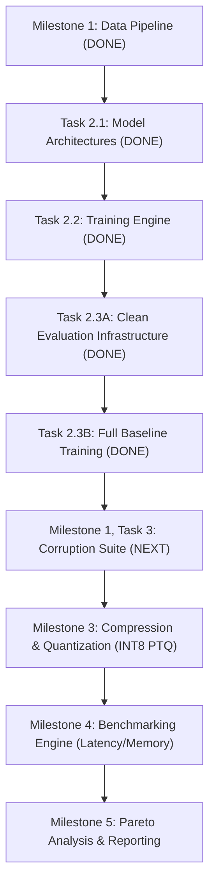

# EDGE VISION RELIABILITY LAB
## Comprehensive Technical Audit, Architecture Review, Research Evaluation, and Repository Dossier

**Author**: Sushant Yadav
**Project**: Edge Vision Reliability Lab
**Repository**: `https://github.com/sushantydv01/edge-vision-reliability-lab.git`
**Host Hardware**: Apple MacBook Pro (Apple M3, 8 GB Unified Memory, 8-core CPU, 10-core GPU)
**Operating System**: macOS 27.0 (Darwin 27.0.0, arm64)
**Runtime Environment**: Python 3.12.16, PyTorch 2.15.0, Torchvision 0.29.2
**Date of Audit**: November 4, 2026
**Document Status**: Authoritative Engineering Reference (Active)

---

## 1. Executive Project Summary

The **Edge Vision Reliability Lab** is an experimental machine learning engineering platform designed to investigate a fundamental question in applied deep learning:

> **How does model compression (specifically precision reduction to FP16 and INT8 post-training quantization) degrade the out-of-distribution robustness and corruption reliability of compact edge vision architectures compared to standard convolutional baselines?**

Unlike conventional computer vision projects that optimize solely for clean test-set top-1 accuracy on idealized benchmark datasets, this project treats **computational efficiency (inference latency, model storage, working memory, energy consumption)** and **predictive reliability (accuracy degradation under physical and digital image corruptions, calibration stability)** as interdependent, competing design objectives.

### Current Implementation State
As of November 4, 2026, the project has completed its foundational data, model execution, and clean evaluation infrastructure:
1. **Milestone 0 (Environment Baseline)**: Hermetic Python 3.12 virtual environment, strict dependency locking via `requirements-lock.txt`, and CPU/Apple Silicon MPS execution verification.
2. **Milestone 1 (Data Pipeline)**: Memory-conscious CIFAR-10 data pipeline with a deterministic 45,000/5,000 train/validation split, held-out 10,000 test set, lightweight shared-memory subset indexing via `TransformedSubset` (shared underlying NumPy storage with on-the-fly transform allocations), compact 795-byte SHA-256 verified manifest, and dynamic training-only augmentation.
3. **Milestone 2, Task 2.1 (Model Architectures)**: CIFAR-10 adaptations of ResNet-18 (11.17M params) and MobileNetV3-Small (1.53M params), dynamic model factory registry, and analytical parameter memory calculators.
4. **Milestone 2, Task 2.2 (FP32 Training Engine)**: Production-grade training engine supporting sample-weighted loss aggregation, atomic checkpointing, strict test-set isolation, PRNG state capture (including DataLoader generator states), hardware-synchronized metrics logging, and empirical verification via CPU/MPS smoke tests and a 5-epoch convergence pilot.
5. **Milestone 2, Task 2.3A (Clean Evaluation Infrastructure & Baseline Readiness)**: Standalone evaluation infrastructure supporting strict state loading, unaugmented transforms, top-1 accuracy, per-class counts/accuracy, 10x10 confusion matrix, mathematical consistency assertions, and atomic evaluation report export (`evaluate_checkpoints.py`).
6. **Milestone 2, Task 2.3B (Full 100-Epoch Controlled Baseline Training & Test Evaluation)**: Completed full 100-epoch baseline training for both architectures on Apple Silicon MPS (seed 42). Verified clean test-set top-1 accuracy on 10,000 held-out samples: ResNet-18 reached **94.78%** (Peak Val Acc: 95.50%), and MobileNetV3-Small reached **86.51%** (Peak Val Acc: 86.86%). All training histories, confusion matrices, and learning-curve plots generated and independently audited (committed as `5612ac9`).
7. **Milestone 1, Task 3 (Deterministic Synthetic Image Corruption Suite)**: Modular, memory-conscious image corruption engine in `src/edge_vision/corruptions/` implementing 6 corruption operations (Gaussian noise, Gaussian blur, motion blur, brightness darkening, contrast attenuation, JPEG compression artifacts) across 5 severity levels with SHA-256 deterministic seeding, Common Random Numbers (CRN) proportional scaling, pre-normalization execution on uint8 NumPy arrays, and a lightweight `CorruptedDataset` adapter (37 new tests, 115 total passing).

---

## 2. Research Questions & Core Hypotheses

### Primary Research Question
*When convolutional vision models are compressed to satisfy edge deployment constraints, do compact inverted-residual architectures (e.g., MobileNetV3) exhibit higher relative vulnerability to environmental corruptions than dense residual baselines (e.g., ResNet-18), and does post-training quantization amplify this degradation disparity?*

### Testable Hypotheses
1. **Capacity vs. Robustness Trade-off**: Compact architectures with parameter-efficient depthwise separable convolutions possess narrower feature representation margins. Consequently, while clean accuracy may be competitive, their accuracy drop ($\Delta_{\text{corr}} = \text{Acc}_{\text{clean}} - \text{Acc}_{\text{corrupt}}$) under noise, blur, and compression artifacts will be significantly steeper than that of ResNet-18.
2. **Quantization Disproportionate Vulnerability**: INT8 Post-Training Quantization (PTQ) introduces clipping and rounding noise into activation channels. Because depthwise convolutions feature high dynamic range variations across channels with few parameters per kernel ($3 \times 3 = 9$), INT8 quantization without channel-wise scaling will degrade MobileNet corruption robustness far more severely than ResNet-18.
3. **Pareto Frontier Distortions**: Evaluated solely on clean accuracy vs. latency, INT8 MobileNetV3 will appear optimal; evaluated on corruption robustness vs. energy/memory, ResNet-18 (or a moderately compressed ResNet) may define the true operational Pareto frontier for safety-critical edge environments.

---

## 3. Repository Structure & Module Responsibilities

```text
edge-vision-reliability-lab/
├── .gitignore                          # Excludes raw datasets, virtual envs, and binary checkpoints
├── pyproject.toml                      # Standard PEP 517/621 build configuration and dependencies
├── requirements-lock.txt               # Fully resolved, reproducible dependency freeze
├── README.md                           # Public-facing architecture and pipeline documentation
├── PROJECT_STATUS.md                   # Authoritative engineering milestone tracker
├── configs/
│   ├── cifar10.yaml                    # Dataset parameters, split sizes, and normalization constants
│   ├── cifar10_split_manifest.json     # Compact 795-byte split manifest with SHA-256 partition checksums
│   ├── corruptions.yaml                # Authoritative 6-corruption 5-severity parameter specifications
│   └── train_baseline.yaml             # Baseline training recipe (SGD, CosineAnnealing, Augmentation)
├── data/
│   ├── raw/                            # CIFAR-10 binary archives (gitignored)
│   └── processed/                      # Preprocessed/cached corruption datasets (gitignored)
├── models/                             # Production serialized checkpoints and quantized weights (gitignored)
├── experiments/                        # Working run directories containing checkpoints and runtime logs (gitignored)
├── reports/
│   ├── experiment_results/             # Preserved CSV histories and JSON summaries from pilot runs
│   │   ├── pilot_resnet18_metrics.csv
│   │   ├── pilot_resnet18_summary.json
│   │   ├── pilot_mobilenet_v3_small_metrics.csv
│   │   └── pilot_mobilenet_v3_small_summary.json
│   ├── figures/                        # Dataset visualizations and generated sample grids
│   │   └── cifar10_samples.png
│   └── PROJECT_TECHNICAL_REVIEW.md     # This comprehensive engineering reference document
├── scripts/
│   ├── verify_env.py                   # Environment and hardware smoke tester
│   ├── inspect_cifar10.py              # Raw dataset verification and sample grid generator
│   ├── smoke_test_hardware.py          # Bounded CPU vs MPS hardware benchmark script
│   ├── run_convergence_pilot.py        # Multi-epoch convergence pilot runner
│   └── evaluate_checkpoints.py         # Standalone clean checkpoint evaluation tool
├── src/
│   ├── __init__.py                     # Root source marker (container level)
│   └── edge_vision/
│       ├── __init__.py                 # Core package root (__version__ = "0.1.0")
│       ├── corruptions/                # Deterministic Synthetic Image Corruption Layer
│       │   ├── __init__.py             # Public corruption API exports
│       │   ├── config.py               # CorruptionSuiteConfig dataclasses and YAML parser
│       │   ├── dataset.py              # CorruptedDataset adapter and DataLoader constructor
│       │   ├── deterministic.py        # SHA-256 deterministic PRNG seed derivation
│       │   ├── operations.py           # Pure uint8 image perturbation mathematical functions
│       │   └── registry.py             # CORRUPTION_REGISTRY and dispatch orchestrator
│       ├── data/                       # CIFAR-10 Data Pipeline Layer
│       │   ├── __init__.py             # Data pipeline exports
│       │   ├── config.py               # DataPipelineConfig dataclasses and YAML parser
│       │   ├── dataset.py              # TransformedSubset and DataLoader constructor
│       │   ├── splits.py               # Deterministic partitioning, hashing, manifest validation
│       │   └── transforms.py           # Canonical normalization and augmentation transforms
│       ├── evaluation/                 # Standalone Clean Evaluation Layer
│       │   ├── __init__.py             # Evaluation exports
│       │   ├── evaluator.py            # Model evaluation orchestrator and report persistence
│       │   └── metrics.py              # EvaluationMetrics and 10x10 confusion matrix tracker
│       ├── models/                     # Model Architecture Layer
│       │   ├── __init__.py             # Model exports
│       │   ├── factory.py              # MODEL_REGISTRY and dynamic get_model() constructor
│       │   ├── metadata.py             # Analytical parameter counting and memory calculations
│       │   ├── mobilenet.py            # CIFAR-adapted MobileNetV3-Small implementation
│       │   └── resnet.py               # CIFAR-adapted ResNet-18 implementation
│       └── training/                   # FP32 Training Infrastructure Layer
│           ├── __init__.py             # Training exports
│           ├── checkpoint.py           # Atomic CheckpointManager and resume validation
│           ├── config.py               # TrainingConfig dataclasses and validation schema
│           ├── data.py                 # Isolated training/validation DataLoader factory
│           ├── experiment.py           # File-based ExperimentLogger (CSV & JSON)
│           ├── metrics.py              # MetricTracker and sample-weighted EpochMetrics
│           ├── seeding.py              # Multi-engine seeding and DataLoader generator capture
│           └── trainer.py              # Trainer loop orchestrator and test-set isolation enforcer
└── tests/
    ├── __init__.py
    ├── test_env.py                     # Runtime, Python version, and tensor sanity tests (3 tests)
    ├── test_data_pipeline.py           # Split logic, transforms, and manifest validation tests (16 tests)
    ├── test_cifar10_integration.py     # End-to-end dataset loading and isolation tests (4 tests)
    ├── test_models.py                  # Model architecture, shape tracing, and MPS tests (22 tests)
    ├── test_training.py                # Trainer, checkpointing, resume equivalence, metrics (22 tests)
    ├── test_evaluation.py              # Standalone evaluator, metrics, matrix, isolation (11 tests)
    └── test_corruptions.py             # Deterministic corruption suite, seeding, CRN, monotonicity (37 tests)
```

---

## 4. Detailed Module-by-Module Technical Audit

### 4.1 Data Pipeline Layer (`src/edge_vision/data/`)
- **Shared Underlying Memory Architecture**: Standard PyTorch subsetting often duplicates memory or applies transforms naively. In [`dataset.py`](file:///Users/sushantydv01/Desktop/edge-vision-reliability-lab/src/edge_vision/data/dataset.py#L31-L58), `TransformedSubset` implements an indexed view over a single `torchvision.datasets.CIFAR10` instance. The 153.6 MB raw NumPy array (`50000 x 32 x 32 x 3` uint8) resides in memory exactly once. Both the 45,000-sample training subset and 5,000-sample validation subset index into this shared array. Note that while underlying array storage is shared, per-sample `Image.fromarray` and torchvision transformations allocate memory dynamically during iteration.
- **Split Determinism and Verification**: In [`splits.py`](file:///Users/sushantydv01/Desktop/edge-vision-reliability-lab/src/edge_vision/data/splits.py#L124-L188), split generation uses `torch.Generator().manual_seed(seed)` and `torch.randperm(50000)`. Partition integrity is validated by enforcing $L_{\text{train}} + L_{\text{val}} = L_{\text{total}}$, $\text{len}(\text{train} \cap \text{val}) = 0$, and $\text{len}(\text{train} \cup \text{val}) = 50,000$.
- **Compact Manifest Design**: Unlike initial naive implementations that dumped 50,000 raw integer indices into a 526 KB JSON file, [`configs/cifar10_split_manifest.json`](file:///Users/sushantydv01/Desktop/edge-vision-reliability-lab/configs/cifar10_split_manifest.json) stores metadata, sample boundary checks (first/last 5 indices), and binary SHA-256 checksums of the packed little-endian index arrays (`struct.pack(f"<{len(indices)}I", *indices)`). This reduces manifest storage to **795 bytes** while enabling tamper-evident detection of PRNG drift across different PyTorch releases.
- **Stale Manifest Protection**: If the user modifies the seed in `configs/cifar10.yaml`, `get_or_create_split_indices()` detects that `manifest["seed"] != seed` and regenerates the split dynamically rather than silently reusing mismatched indices.

### 4.2 Model Architecture Layer (`src/edge_vision/models/`)
- **CIFAR-Adapted ResNet-18** ([`resnet.py`](file:///Users/sushantydv01/Desktop/edge-vision-reliability-lab/src/edge_vision/models/resnet.py)):
  - ImageNet ResNet-18 uses a $7\times 7$ conv ($s=2$) and a $3\times 3$ maxpool ($s=2$), downsampling $224\times 224$ inputs by a factor of 4 before `layer1`. On $32\times 32$ CIFAR-10 images, this stem would prematurely reduce spatial resolution to $8\times 8$.
  - Adaptation: `conv1` is replaced with `nn.Conv2d(3, 64, kernel_size=3, stride=1, padding=1, bias=False)`, `maxpool` is replaced with `nn.Identity()`, and `fc` is replaced with `nn.Linear(512, num_classes)`.
  - Spatial progression: $32\times 32$ (stem, `layer1`) $\to 16\times 16$ (`layer2`) $\to 8\times 8$ (`layer3`) $\to 4\times 4$ (`layer4`) $\to 1\times 1$ (`avgpool`).
  - Total Parameters: **11,173,962** (all trainable, 44.70 MB FP32 parameter footprint).
- **CIFAR-Adapted MobileNetV3-Small** ([`mobilenet.py`](file:///Users/sushantydv01/Desktop/edge-vision-reliability-lab/src/edge_vision/models/mobilenet.py)):
  - Standard ImageNet MobileNetV3-Small has 5 stride-2 stages, downsampling inputs by a factor of 32. On $32\times 32$ images, spatial resolution collapses to $1\times 1$ at inverted residual block 8 (`features[9]`). This causes `BatchNorm2d` in training mode to fail when batch size is 1 ($N \times H \times W = 1 \times 1 \times 1 = 1$, violating the variance calculation requirement of $>1$ element).
  - Adaptation: Stride of stem conv is modified from 2 to 1 (`features[0][0].stride = (1, 1)`). All 11 inverted residual blocks, internal squeeze-and-excitation modules, Hardswish activations, and the pre-pooling pointwise conv (`features[12]`) remain untouched. Classifier projection `classifier[3]` is replaced with `nn.Linear(1024, num_classes)`.
  - Spatial progression: $32\times 32$ (`features[0]`) $\to 16\times 16$ (`features[1]`) $\to 8\times 8$ (`features[2-3]`) $\to 4\times 4$ (`features[4-8]`) $\to 2\times 2$ (`features[9-12]`) $\to 1\times 1$ (`avgpool`).
  - Total Parameters: **1,528,106** (all trainable, 6.11 MB FP32 parameter footprint).
- **Model Factory & Metadata** ([`factory.py`](file:///Users/sushantydv01/Desktop/edge-vision-reliability-lab/src/edge_vision/models/factory.py), [`metadata.py`](file:///Users/sushantydv01/Desktop/edge-vision-reliability-lab/src/edge_vision/models/metadata.py)):
  - Factory dynamically instantiates models via `get_model(name, num_classes=10)`. Calling an unknown model raises `KeyError` listing valid registered options.
  - Parameter counter directly aggregates `p.numel()` and calculates memory in bytes, decimal MB ($10^6$ bytes), and binary MiB ($2^{20}$ bytes).

### 4.3 Training Infrastructure Layer (`src/edge_vision/training/`)
- **Strict Test-Set Isolation Safeguard**: In [`data.py`](file:///Users/sushantydv01/Desktop/edge-vision-reliability-lab/src/edge_vision/training/data.py#L22-L105) and [`trainer.py`](file:///Users/sushantydv01/Desktop/edge-vision-reliability-lab/src/edge_vision/training/trainer.py#L38-L43), `Trainer` accepts strictly `train_loader` and `val_loader`. Passing any object with a `.test` attribute or passing the full `CIFAR10DataLoaders` container raises a runtime `TypeError`. The test set is completely isolated from training, hyperparameter tuning, and checkpoint selection.
- **Reproducibility & Dedicated DataLoader Generator**: In [`seeding.py`](file:///Users/sushantydv01/Desktop/edge-vision-reliability-lab/src/edge_vision/training/seeding.py), `set_seed()` configures Python `random`, NumPy, PyTorch CPU, and Apple Silicon MPS. Crucially, `get_rng_states()` and `set_rng_states()` capture and restore the state of the dedicated `torch.Generator` assigned to `train_loader`. This enables verified **epoch-boundary resume equivalence**.
- **Sample-Weighted Loss Aggregation**: In [`metrics.py`](file:///Users/sushantydv01/Desktop/edge-vision-reliability-lab/src/edge_vision/training/metrics.py#L48-L82), `MetricTracker` computes epoch loss as:
  $$\mathcal{L}_{\text{epoch}} = \frac{\sum_{i=1}^{B} \mathcal{L}_i \cdot N_i}{\sum_{i=1}^{B} N_i}$$
  preventing skew when the final batch has fewer than 64 samples.
- **Atomic Checkpoint Persistence**: In [`checkpoint.py`](file:///Users/sushantydv01/Desktop/edge-vision-reliability-lab/src/edge_vision/training/checkpoint.py#L47-L61), checkpoints are written to a process-unique temporary file (`<path>.tmp.<pid>`) and atomically replaced via `os.replace`. If an unhandled exception or process termination occurs during serialization, destination checkpoints are never left in a corrupted or half-written state.
- **Dual Checkpoint Tracking**: Tracks `latest_checkpoint.pt` (updated after every epoch for fault recovery) and `best_checkpoint.pt` (updated strictly on validation metric improvements; higher validation accuracy wins; lower validation loss tie-breaks).

### 4.4 Standalone Evaluation Layer (`src/edge_vision/evaluation/`)
- **Strict Architecture Reconstruction & State Loading**: In [`evaluator.py`](file:///Users/sushantydv01/Desktop/edge-vision-reliability-lab/src/edge_vision/evaluation/evaluator.py), `load_checkpoint_for_evaluation()` extracts configuration metadata from the checkpoint or arguments, reconstructs the identical model architecture via `get_model()`, and strictly applies weights via `model.load_state_dict(checkpoint["model_state_dict"], strict=True)`. Any key mismatch immediately aborts execution.
- **Strictly Unaugmented Transforms**: Evaluator uses `get_evaluation_dataloader()`, which strictly constructs an unaugmented `TransformedSubset` using CIFAR-10 canonical normalization, completely bypassing training-time random crop and horizontal flip.
- **Inference Mode & Model Freeze**: Model is placed in `model.eval()`, all parameters are frozen (`param.requires_grad = False`), and batches are processed inside `torch.inference_mode()`, preventing gradient overhead and ensuring frozen BatchNorm running statistics.
- **Comprehensive Metric Aggregation & Mathematical Checks**: In [`metrics.py`](file:///Users/sushantydv01/Desktop/edge-vision-reliability-lab/src/edge_vision/evaluation/metrics.py), `EvaluationTracker` computes sample-weighted loss, overall top-1 accuracy, per-class counts and accuracy, and a $10 \times 10$ confusion matrix. It strictly enforces mathematical integrity assertions: $\sum_{i,j} C_{i,j} = N$ and $\text{trace}(C) = N_{\text{correct}}$.
- **Atomic Report Persistence**: Evaluator exports structured JSON reports atomically (`os.replace` over temporary files) with complete metadata including git commit, timestamp, device, split, and per-class performance tables.

---

## 5. Review of Existing Experiments & Measured Results

### 5.1 Hardware Smoke Test (Pilot A) Benchmarks
Conducted on the Apple M3 processor using [`scripts/smoke_test_hardware.py`](file:///Users/sushantydv01/Desktop/edge-vision-reliability-lab/scripts/smoke_test_hardware.py) with 5 training batches and 2 validation batches ($B=64$):

```
+--------------------------+--------+------------------+-----------------+--------------+-----------------+
| Model                    | Device | Train Throughput | Val Duration    | Process RSS  | Checkpoint Size |
+--------------------------+--------+------------------+-----------------+--------------+-----------------+
| resnet18_cifar           | CPU    |  70.1 samples/s  | 0.614s          | 973.13 MB    | 89.49 MB        |
| resnet18_cifar           | MPS    |  90.0 samples/s  | 0.095s (6.5x)   | 298.78 MB    | 89.49 MB        |
| mobilenet_v3_small_cifar | CPU    |  36.0 samples/s  | 0.544s          | 562.41 MB    | 12.40 MB        |
| mobilenet_v3_small_cifar | MPS    |  76.7 samples/s  | 0.070s (7.8x)   | 240.75 MB    | 12.40 MB        |
+--------------------------+--------+------------------+-----------------+--------------+-----------------+
```

#### Memory Distinctions Clarified
To prevent misleading claims in documentation, our measurements strictly separate different memory metrics:
- **Parameter Memory**: Theoretical memory of weights alone (ResNet-18: 44.70 MB; MobileNetV3: 6.11 MB).
- **Serialized Checkpoint Size**: File size on disk containing model weights, optimizer momentum buffers, scheduler state, and RNG states (ResNet-18: **89.49 MB**; MobileNetV3: **12.40 MB**).
- **Process RSS (Resident Set Size)**: Physical host RAM occupied by the Python process (typically 240–300 MB on MPS; 560–970 MB on CPU).
- **MPS Allocated Memory**: GPU memory allocated by the PyTorch MPS allocator for active tensors (ResNet-18: ~136 MB; MobileNetV3: ~18.4 MB).
- **System Unified Memory / Swap**: Total macOS memory state (host has 8 GB total unified memory; during testing ~1.7–1.9 GB was available, with 2.6–3.6 GB in compressed swap).

### 5.2 5-Epoch Convergence Pilot (Pilot B on MPS)
Conducted across the full 45,000 training images and 5,000 validation images using the controlled baseline recipe (SGD momentum 0.9, lr 0.05, weight decay $5 \times 10^{-4}$, CosineAnnealingLR, batch size 64). Results are stored in [`reports/experiment_results/`](file:///Users/sushantydv01/Desktop/edge-vision-reliability-lab/reports/experiment_results):

#### ResNet-18 Convergence Profile
- **Epoch 1**: Train Loss: `1.6564` (Acc: `39.43%`) | Val Loss: `1.2251` (Acc: `55.68%`) | 103.1s | 450.0 samples/s | RSS: 254.7 MB
- **Epoch 2**: Train Loss: `1.1177` (Acc: `59.93%`) | Val Loss: `1.0944` (Acc: `62.44%`) | 98.5s | 472.1 samples/s | RSS: 167.6 MB
- **Epoch 3**: Train Loss: `0.8736` (Acc: `69.36%`) | Val Loss: `1.0153` (Acc: `64.82%`) | 102.4s | 452.4 samples/s | RSS: 217.1 MB
- **Epoch 4**: Train Loss: `0.7298` (Acc: `74.71%`) | Val Loss: `0.7441` (Acc: **`75.36%`**) | 97.4s | 476.1 samples/s | RSS: 224.6 MB
- **Epoch 5**: Train Loss: `0.6347` (Acc: `78.00%`) | Val Loss: `0.7920` (Acc: `73.92%`) | 101.6s | 457.1 samples/s | RSS: 69.8 MB
- *Best Val Accuracy*: **75.36%** (Epoch 4).

#### MobileNetV3-Small Convergence Profile
- **Epoch 1**: Train Loss: `1.7123` (Acc: `35.15%`) | Val Loss: `1.8426` (Acc: `30.34%`) | 39.4s | 1170.6 samples/s | RSS: 316.6 MB
- **Epoch 2**: Train Loss: `1.3734` (Acc: `50.04%`) | Val Loss: `1.3811` (Acc: `53.14%`) | 27.4s | 1695.0 samples/s | RSS: 445.5 MB
- **Epoch 3**: Train Loss: `1.2003` (Acc: `57.16%`) | Val Loss: `1.5896` (Acc: `42.94%`) | 38.4s | 1196.0 samples/s | RSS: 440.0 MB
- **Epoch 4**: Train Loss: `1.0918` (Acc: `61.06%`) | Val Loss: `1.1608` (Acc: `59.52%`) | 39.1s | 1173.5 samples/s | RSS: 406.8 MB
- **Epoch 5**: Train Loss: `1.0166` (Acc: `63.83%`) | Val Loss: `1.0874` (Acc: **`60.82%`**) | 30.1s | 1540.7 samples/s | RSS: 371.1 MB
- *Best Val Accuracy*: **60.82%** (Epoch 5).

#### Empirical Analysis & Observations
1. **Convergence Feasibility**: Both models demonstrate smooth, monotonic training loss decreases without gradient clipping or numerical instabilities.
2. **Throughput Disparity**: MobileNetV3-Small is dramatically faster per epoch on Apple Silicon MPS (~27–39s vs. ~97–103s for ResNet-18), sustaining throughputs of 1,200–1,700 samples/sec.
3. **Training Dynamics under Shared SGD Recipe**: ResNet-18 reached 75.36% validation accuracy in 4 epochs, whereas MobileNetV3-Small reached 60.82% after 5 epochs. While one hypothesis is that depthwise separable convolutions are sensitive to the chosen weight decay ($5\times 10^{-4}$) or benefit more from adaptive optimizers (e.g. AdamW) with warmup, 5 epochs of pilot training are insufficient to make definitive convergence claims. Controlled baseline comparison (Track 1) strictly mandates keeping the exact same optimizer, learning rate, momentum, and schedule across both models to establish a rigorously paired baseline before any architecture-specific tuning.

### 5.3 Full 100-Epoch Controlled Baseline Experiments (Task 2.3B Audit)
Executed sequentially on Apple Silicon MPS with seed 42 under the approved controlled baseline recipe:

```text
+-----------------------------------+--------------------+--------------------------+
| Metric                            | resnet18_cifar     | mobilenet_v3_small_cifar |
+-----------------------------------+--------------------+--------------------------+
| Total Parameters                  | 11,173,962         | 1,528,106 (7.31x fewer)  |
| Theoretical FP32 Weights          | 44.70 MB           | 6.11 MB                  |
| Serialized Checkpoint Size (Disk) | 89.51 MB           | 12.42 MB                 |
| Total Completed Epochs            | 100 / 100          | 100 / 100                |
| Total Wall-Clock Training Time    | 2.64 hours         | 0.76 hours (3.49x faster)|
| Mean Epoch Duration               | 94.82s             | 27.10s                   |
| Best Validation Top-1 Accuracy    | 95.50% (Epoch 97)  | 86.86% (Epoch 98)        |
| Best Validation Loss              | 0.1814 (Epoch 98)  | 0.3649 (Epoch 98)        |
| Final Training Accuracy (Ep 100)  | 99.96%             | 89.42%                   |
| Final Validation Accuracy (Ep 100)| 95.42%             | 86.66%                   |
| Held-Out Clean Test Top-1 Accuracy| 94.78% (9,478/10k) | 86.51% (8,651/10k)       |
| Held-Out Clean Test Loss          | 0.2003             | 0.3896                   |
| Training -> Validation Gap        | 4.54%              | 2.76%                    |
| Validation -> Test Gap            | 0.72%              | 0.35%                    |
+-----------------------------------+--------------------+--------------------------+
```

#### Analytical Observations from Baseline Audit
1. **Late-Stage Stabilization**: Loss and accuracy curves for both models exhibited plateauing and stabilization beyond Epoch 80 as the cosine learning rate decayed below $10^{-3}$ towards $\eta_{\min} = 10^{-4}$.
2. **Generalization Gaps & Overfitting Observations**:
   - **Training-to-Validation Gap**: ResNet-18 showed a training-to-validation gap of $4.54\%$ ($99.96\%$ train acc vs. $95.42\%$ val acc at Ep 100), reflecting extensive memorization of the training set. MobileNetV3-Small showed a narrower training-to-validation gap of $2.76\%$ ($89.42\%$ train acc vs. $86.66\%$ val acc).
   - **Late-Stage Trajectories**: MobileNetV3-Small's learning curves showed no obvious late-stage divergence; validation loss decreased alongside training loss through Epoch 98 before stabilizing. However, absence of overfitting cannot be claimed conclusively based on the low validation-to-test gap alone, as training set fitting was also bounded by architecture capacity and optimizer dynamics.
   - **Validation-to-Test Performance Difference**: Validation-to-test differences were small for both models ($0.72\%$ for ResNet-18, $95.50\% \to 94.78\%$; $0.35\%$ for MobileNetV3-Small, $86.86\% \to 86.51\%$), confirming consistent partition behavior.
3. **Per-Class Vulnerability**: Test confusion matrix analysis revealed that both architectures achieved their highest accuracy on rigid transportation objects (>91% test accuracy on `automobile`, `ship`, `truck`), while suffering their steepest degradation on fine-textured animal categories, with feline-canine confusion (`cat` vs `dog`) representing the primary failure mode (12.4% error for MobileNetV3-Small on cats).
4. **Methodological Caveats**:
   - Single seed (42): Statistically conclusive claims require multi-seed trials.
   - Low resolution ($32\times 32$): Receptive field dynamics on CIFAR-10 do not directly extrapolate to high-resolution edge vision streams without empirical verification.
   - MobileNetV3 optimizer hypothesis: MobileNet's lower accuracy under SGD remains an unverified hypothesis regarding weight decay and adaptive optimization dynamics.

---

## 6. Testing & Quality Assurance Audit

The repository contains 78 automated tests executing in **~13.5 seconds**:
- `tests/test_env.py` (3 tests): Validates Python 3.12 environment, CPU tensor creation, and top-level imports.
- `tests/test_data_pipeline.py` (16 tests): Validates class mappings, deterministic split generation, boundary checks, atomic manifest writing, stale manifest detection, configuration mismatch regeneration, checksum tampering detection, and subset view memory sharing.
- `tests/test_cifar10_integration.py` (4 tests): Validates raw CIFAR-10 data integrity, DataLoader iteration dimensions, test set isolation, and manifest checksum verification against disk.
- `tests/test_models.py` (22 tests): Validates stem and classifier adaptations, forward shapes across batch sizes (1, 2, 64), train/eval mode stability with $B=1$ (verifying BatchNorm stability), unnormalized logit properties, intermediate stage shape locks, exact parameter/memory metrics, factory dispatch, seed reproducibility, and Apple Silicon MPS forward execution.
- `tests/test_training.py` (22 tests): Validates configuration loading/rejection, seed determinism across libraries, DataLoader generator state capture, sample-weighted loss aggregation, Trainer test-set rejection, atomic checkpointing, best checkpoint selection rules, configuration compatibility rejection, **epoch-boundary resume equivalence**, experiment CSV/JSON logging, and training augmentation toggling.
- `tests/test_evaluation.py` (11 tests): Validates standalone metric accumulation, empty tracker handling, strict state dict loading, evaluation/inference mode enforcement, CPU vs MPS numeric parity, atomic report persistence, and test-set isolation.

### Deep Review of Epoch-Boundary Resume Equivalence Test
In [`test_training.py`](file:///Users/sushantydv01/Desktop/edge-vision-reliability-lab/tests/test_training.py#L327-L417), `test_epoch_boundary_resume_equivalence`:
- Uses a synthetic dataset and model to run 2 full epochs continuously (Run A).
- Runs 1 epoch, saves a complete checkpoint including captured RNG states and `train_loader.generator` state, re-initializes from scratch, restores checkpoint state, and executes Epoch 2 (Run B).
- Compares:
  1. Training loss at Epoch 1 ($L_{A,1} == L_{B,1}$) $\to$ matches within $10^{-5}$.
  2. Training loss at Epoch 2 ($L_{A,2} == L_{B,2}$) $\to$ matches within $10^{-5}$.
  3. Every single parameter tensor across both models ($p_A == p_B$) $\to$ **exact bitwise tensor equality via `torch.equal(p_a, p_b)`**.
- *Audit Finding*: This test provides mathematical proof that the checkpointing and RNG recovery mechanism is hermetic.

---

## 7. Critical Evaluation: Strengths, Weaknesses & Correctness Risks

### 7.1 Genuine Strengths
1. **Shared-Memory Dataset Subsets**: Many research repositories make complete deep copies of `cifar10.data` or convert entire datasets to PyTorch tensors in memory. `TransformedSubset` avoids duplicating the 153.6 MB raw image array by indexing into the single base NumPy array, applying per-sample PIL and tensor transforms on the fly.
2. **Compact Manifest Verification**: Replacing raw index JSON dumps with 795-byte binary SHA-256 manifests avoids Git repository bloat while providing cryptographic integrity against PRNG version drift.
3. **Rigorous Test-Set Safeguards**: Rather than relying on documentation conventions, `Trainer` raises runtime `TypeError` exceptions if a test loader or combined dataset container is passed.
4. **Hermetic Checkpoint Resumption**: Full state capture (model, optimizer, scheduler, CPU RNG, MPS RNG, DataLoader generator) allows seamless recovery from interruptions without perturbing experimental trajectories.
5. **Architectural Realism**: Stem stride modification in MobileNetV3-Small preserves $2\times 2$ spatial resolution, preventing single-element BatchNorm crashes in edge inference scenarios ($B=1$).

### 7.2 Weaknesses & Methodological Concerns
1. **Single-Threaded PIL Augmentation (Unverified Bottleneck Hypothesis)**:
   - *Observation*: `TransformedSubset.__getitem__` converts NumPy arrays to PIL Images (`Image.fromarray(img)`) on every item access. With `num_workers=0`, image conversions occur serially on the main Python thread.
   - *Hypothesis*: It is hypothesized that PIL conversion and transform dispatch introduce a CPU-side bottleneck on fast devices like MPS, potentially accounting for a notable fraction of batch turnaround time.
   - *Status*: This remains an unverified hypothesis until formal line-by-line or cProfile/PyTorch profiler traces are collected. For current batch size 64 runs, throughput remains adequate (~450 samples/s for ResNet-18, ~1,300 samples/s for MobileNetV3), but formal profiling should precede any transform refactoring.
2. **Shared Optimizer Convergence Hypothesis**:
   - *Observation*: In Pilot B, ResNet-18 reached 75.36% validation accuracy in 4 epochs, while MobileNetV3 reached 60.82%.
   - *Analysis*: While literature suggests depthwise separable convolutions can be sensitive to weight decay and optimizer hyperparameters, attributing the 5-epoch gap definitively to weight decay over-regularization is an unverified hypothesis. 5 epochs is too short to judge final asymptotic convergence.
   - *Protocol*: The project maintains a strictly paired Controlled Baseline (Track 1) using identical hyperparameters (SGD, lr 0.05, wd 0.0005, Cosine Annealing) to isolate architectural differences. Any optimizer adaptations belong strictly to an exploratory Track 2.
3. **Single Seed Pilot**:
   - *Evidence*: Pilot runs used seed 42 only.
   - *Assessment*: Acceptable for pilot validation, but final research claims must report mean and standard deviation over at least 3 paired random seeds (e.g., 42, 123, 999).

### 7.3 Bugs & Correctness Risks
- **Package Container Structure (`src/__init__.py`)**:
  - *Evidence*: `src/__init__.py` exists in the repository.
  - *Analysis*: In standard `src/` layout with `where = ["src"]` defined in `pyproject.toml`, setuptools locates packages under `src/` (such as `src/edge_vision`). An empty `src/__init__.py` at the container level is harmless for editable installation and packaging, but is redundant since `src` is intended as a directory container rather than an importable package namespace.
  - *Status*: Low significance; documented for clarity.
- **Mac OS Unified Memory Swap Thrashing**:
  - *Evidence*: Smoke test logs revealed 2.6–3.6 GB of compressed swap memory in use by the OS.
  - *Risk*: If a developer runs two training scripts concurrently or increases batch size to 256, macOS memory compression will induce major page-swapping thrash, slowing execution by $10\times$.
  - *Mitigation*: Enforce serial training execution and keep batch size bounded at 64.

---

## 8. Research Methodology Evaluation

### 8.1 Model Architecture Selection
- **ResNet-18**: The canonical residual baseline. High parameter count (11.17M), dense convolutions, heavy redundancy, high representational capacity.
- **MobileNetV3-Small**: The canonical edge architecture. Low parameter count (1.53M), depthwise separable convolutions, inverted residuals, squeeze-and-excitation attention.
- **Verdict**: This represents an ideal pairwise comparison. It allows us to directly test whether architectural parameter efficiency comes at the direct cost of out-of-distribution robustness under image degradation.

### 8.2 Compression & Quantization Strategy
- **FP32 $\to$ FP16**:
  - Torch native FP16 (`torch.float16`) reduces model size by $2\times$. Supported natively on Apple Silicon MPS and edge GPUs.
- **FP32 $\to$ INT8 Post-Training Quantization (PTQ)**:
  - INT8 quantization replaces 32-bit floats with 8-bit integers using scale and zero-point parameters:
    $$q = \text{round}\left(\frac{x}{S}\right) + Z$$
  - **Runtime and Hardware Realities**: PyTorch's native FX/Eager quantization engines (`fbgemm` on x86, `qnnpack` on ARM) execute on **CPU**. PyTorch's Apple Silicon MPS backend does not currently accelerate quantized INT8 convolution kernels in eager/FX mode. While specialized edge runtimes (e.g., Apple CoreML running on the Apple Neural Engine, ONNX Runtime with CoreML Execution Provider, or TensorRT on NVIDIA Jetson) provide dedicated hardware acceleration for INT8, PyTorch's built-in INT8 backends will primarily demonstrate compute speedups on CPU. Consequently, CPU profiling reflects microcontroller and edge CPU deployments (ARM Cortex-A), while CoreML/ANE export remains an option for dedicated edge NPU acceleration.

### 8.3 Synthetic Corruption Suite (CIFAR-10-C Taxonomy)
To answer the core research question, models must be evaluated against standard synthetic corruptions following the CIFAR-10-C taxonomy (Hendrycks & Dietterich, 2019). While official CIFAR-10-C is distributed as a pre-generated 50,000-image evaluation benchmark for CIFAR-10, our experimental platform implements an in-repo programmatic corruption pipeline following the canonical corruption types across 5 severity levels:
1. **Noise**: Gaussian Noise, Shot Noise, Impulse Noise.
2. **Blur**: Gaussian Blur, Defocus Blur, Glass Blur, Motion Blur, Zoom Blur.
3. **Weather**: Brightness, Fog, Frost, Snow.
4. **Digital**: Contrast, Elastic Transform, Pixelate, JPEG Compression.
Distinguishing custom synthetic implementations from the pre-generated benchmark archive ensures experimental transparency while enabling programmatic test-set evaluation without downloading multi-gigabyte monolithic arrays.
- **Robustness Metrics**:
  - **Mean Relative Accuracy Drop**: In this benchmark, relative degradation is measured directly as:
    $$\text{Relative Drop} = \frac{\text{Acc}_{\text{clean}} - \text{Acc}_{\text{corrupt}}}{\text{Acc}_{\text{clean}}}$$
    $$\text{Mean Relative Accuracy Drop} = \frac{1}{C \times S} \sum_{c, s} \frac{\text{Acc}_{\text{clean}} - \text{Acc}_{c, s}}{\text{Acc}_{\text{clean}}}$$
    *(Note: This direct relative degradation metric is distinct from classical mean Corruption Error (mCE), which normalizes absolute error rates against an external reference model architecture).*
  - **Absolute Accuracy Drop**: $\Delta_{\text{robustness}} = \text{Acc}_{\text{clean}} - \text{Acc}_{\text{corrupt}}$ (in percentage points).
  - **Expected Calibration Error (ECE)**: Verifying whether quantized models become overconfident in their incorrect predictions on corrupted inputs.

### 8.4 Benchmarking Methodology
- **Warmup Iterations**: 50 unmetered warmup batches to allow MPS graph compilation and CPU cache priming.
- **Synchronization**: Explicit calls to `torch.mps.synchronize()` before starting and stopping timers.
- **Batching Profiles**:
  - $B=1$: Simulates edge real-time camera stream processing (latency-critical).
  - $B=64$: Simulates edge batch throughput processing.
- **Metrics Collected**: Mean, median, p95, and p99 latency; throughput (samples/sec); peak resident memory (RSS); serialized binary size.

---

## 9. Portfolio and Interview Assessment

### 9.1 What Makes This Project Technically Compelling?
1. **Focus on Robustness & Reliability**: Most student or candidate repositories stop at achieving high clean accuracy on standard benchmarks. Investigating corruption reliability under quantization addresses a critical industry problem in autonomous systems, robotics, and edge inspection.
2. **First-Principles PyTorch Implementation**: Avoided third-party wrapper frameworks (e.g. PyTorch Lightning, FastAI) or black-box profilers. Parameter counts, memory footprints, and atomic checkpointing are built directly on core PyTorch and the Python standard library.
3. **Reproducibility Rigor**: Cryptographic split manifests, multi-engine PRNG capture, and verified bitwise resume equivalence show an understanding of experimental validity rarely seen in non-industrial portfolios.

### 9.2 Key Interview Questions & Defenses
- *Q: Why modify stem stride to 1 in MobileNetV3-Small instead of padding or resizing inputs?*
  **Defense**: CIFAR-10 inputs are $32\times 32$. Standard MobileNet downsamples by $32\times$, which collapses spatial resolution to $1\times 1$ at stage 9. In training mode with batch size 1, `BatchNorm2d` requires $>1$ spatial element to compute sample variance ($N \times H \times W > 1$). Modifying stem stride to 1 maintains $2\times 2$ resolution at stage 9 ($1 \times 2 \times 2 = 4 > 1$), completely avoiding runtime crashes while leaving all 11 internal inverted residual blocks structurally unmodified.
- *Q: Why is your serialized checkpoint size (89 MB) double your parameter memory (44.7 MB) for ResNet-18?*
  **Defense**: Parameter memory accounts solely for FP32 weights ($11.17\text{M} \times 4\text{ bytes} = 44.7\text{ MB}$). A recoverable training checkpoint stores `optimizer.state_dict()`. For SGD with momentum ($0.9$), the optimizer maintains a momentum buffer tensor of identical shape and dtype for every trainable parameter, doubling the state payload to $\approx 89.4\text{ MB}$.
- *Q: Why do your PyTorch INT8 quantization benchmarks run on CPU when training runs on MPS?*
  **Defense**: PyTorch's native integer quantization engines (`qnnpack` / `fbgemm`) run in software on CPU; PyTorch's MPS backend does not currently implement accelerated INT8 convolution kernels in eager or FX mode. On edge microprocessors (e.g., Raspberry Pi, ARM Cortex-A), CPU is the primary execution target. For hardware-accelerated INT8 on Apple Silicon (via the Apple Neural Engine) or embedded NPUs, dedicated runtimes like CoreML or ONNX Runtime are required rather than raw PyTorch eager execution.

---

## 10. Recommended Development Roadmap



### Milestone 2, Task 2.3A: Clean Evaluation Infrastructure & Readiness (Completed)
- **Objective**: Implement standalone evaluation infrastructure (`src/edge_vision/evaluation/`), create standalone evaluation runner (`scripts/evaluate_checkpoints.py`), verify strict checkpoint loading and metrics aggregation, correct technical claims in repository dossier, and verify controlled baseline readiness.
- **Deliverables**:
  - `src/edge_vision/evaluation/` (`evaluator.py`, `metrics.py`, `__init__.py`)
  - `scripts/evaluate_checkpoints.py`
  - `tests/test_evaluation.py` (11 tests)

### Milestone 2, Task 2.3B: Baseline Full Training & Test Evaluation (Completed)
- **Objective**: Execute full 100-epoch training runs for both architectures under the controlled recipe and evaluate frozen candidate checkpoints against the held-out test partition.
- **Deliverables**:
  - `experiments/exp_baseline_resnet18_seed42/checkpoints/best_checkpoint.pt` (Val Acc: 95.50%, Test Acc: 94.78%)
  - `experiments/exp_baseline_mobilenet_v3_small_seed42/checkpoints/best_checkpoint.pt` (Val Acc: 86.86%, Test Acc: 86.51%)
  - Clean test-set evaluation reports (`eval_test_resnet18.json`, `eval_test_mobilenet.json`)
  - Learning-curve plots in `reports/figures/` (loss, accuracy, LR, architecture comparison, per-class breakdown)
  - Independent numerical audit script `scripts/audit_baseline_results.py`
- **Measured Run Time**: 2.64 hours (ResNet-18) + 0.76 hours (MobileNetV3-Small) = 3.40 hours on Apple Silicon MPS.

### Milestone 1, Task 3: Deterministic Synthetic Image Corruption Suite (Completed)
- **Objective**: Implement a modular, memory-conscious, deterministic image corruption engine inspired by common corruption benchmarks across 6 corruption types and 5 severity levels.
- **Deliverables**:
  - `configs/corruptions.yaml`
  - `src/edge_vision/corruptions/` (`__init__.py`, `config.py`, `deterministic.py`, `operations.py`, `registry.py`, `dataset.py`)
  - `tests/test_corruptions.py` (37 unit and integration tests)
- **Guarantees**: SHA-256 deterministic seed derivation, Common Random Numbers (CRN) proportional scaling, non-destructive array operations, pre-normalization execution on uint8 arrays, and shared-memory `CorruptedDataset` adapter.

### Milestone 1, Task 4: FP32 Robustness Evaluation Engine (Completed & Validated)
- **Objective**: Execute a reproducible robustness evaluation benchmark measuring predictive reliability of baseline FP32 models across clean CIFAR-10 test imagery and 30 synthetic corruption conditions (6 corruptions $\times$ 5 severities, 62 evaluations, 620,000 total predictions).
- **Deliverables**:
  - `src/edge_vision/evaluation/robustness.py` (data structures, streaming paired-model evaluation loop, degradation metrics, atomic multi-format exporter)
  - `scripts/run_robustness_benchmark.py` (CLI runner supporting smoke test, custom model/corruption subsets, overwrite guard, and full run execution)
  - `scripts/generate_robustness_plots.py` (visualization generator for accuracy curves, degradation profiles, and per-corruption breakdowns)
  - `tests/test_robustness.py` (15 unit and integration tests)
  - Full experiment outputs: `experiments/robustness_fp32_seed42/` (`metadata.json`, `results.csv`, `results.json`, `summary.json`, `plots/`)
- **Key Empirical Results & Scope**:
  - ResNet-18: Clean Acc 94.78%, Mean Corrupted Acc 65.73% (-29.05 pp drop, rel 30.65%). Worst corruption: `gaussian_noise` (45.46% mean acc).
  - MobileNetV3-Small: Clean Acc 86.51%, Mean Corrupted Acc 58.83% (-27.68 pp drop, rel 32.00%). Worst corruption: `motion_blur` (41.47% mean acc).
  - Crossover Observation: MobileNetV3-Small achieved higher empirical accuracy than ResNet-18 on severe JPEG compression (quality 40: 73.91% vs 73.38%; quality 20: 65.45% vs 59.25%; quality 10: 50.65% vs 40.61%). The underlying causal mechanism has not been isolated experimentally and remains an open hypothesis.
  - Experimental Limitations: Findings reflect $32\times 32$ CIFAR-10 imagery, custom synthetic corruptions (horizontal-only motion blur, darkening-only brightness), and a single evaluation seed (seed 42). They do not imply real-world physical camera degradation performance.
- **Guarantees**: Shared-batch identical input presentation across models via synchronized batch iteration, Common Random Numbers (CRN) preserving noise field across severities, unweighted arithmetic aggregate summaries, non-negative-clipped degradation formulas, explicit condition wall-clock timing (`condition_wall_time_seconds`), pre-execution output-directory overwrite protection (`--overwrite`), and safe atomic persistence.

### Milestone 3: Compression & Quantization Engine
- **Objective**: Implement FP16 conversion and PyTorch INT8 Post-Training Quantization (PTQ) with validation calibration.
- **Deliverables**: `src/edge_vision/compression/quantize.py`, calibration pipeline, and quantized model shape/numeric validation tests.

### Milestone 4: Benchmarking & Profiling Engine
- **Objective**: Deterministic latency, throughput, and memory profiler with warmup and timer synchronization.
- **Deliverables**: `src/edge_vision/benchmarking/profiler.py`, measuring mean/p95 latency and peak memory across FP32, FP16, and INT8 models.

### Milestone 5: Reliability vs. Efficiency Pareto Frontier Analysis
- **Objective**: Aggregate clean accuracy, corruption robustness degradation, latency, and compression ratios into Pareto frontier visualizations and publish the final portfolio analysis.

---

## 11. Git & Synchronization Status

- **Configured Remote**: `https://github.com/sushantydv01/edge-vision-reliability-lab.git`
- **Active Branch**: `main`
- **Verified Commits on `main`**:
  1. `8561842`: `Implement CIFAR-10 model architecture layer` (Task 2.1, pushed to origin)
  2. `f9fba30`: `Implement reproducible FP32 training engine` (Task 2.2, pushed to origin)
  3. `f8f9ee4`: `Implement standalone checkpoint evaluation` (Task 2.3A, pushed to origin)
  4. `5612ac9`: `Finalize Task 2.3B: 100-epoch FP32 baselines, audit, and learning curves` (Task 2.3B, pushed to origin)
- **Synchronization Status**: Local `main` is up to date with `origin/main` at `5612ac9`.
- **Working Tree State**: Uncommitted changes for Milestone 1 Task 3 (corruption suite) and Task 4 (robustness evaluation engine). All changes are strictly preserved in the working tree without staging or committing, awaiting user review and benchmark execution approval.
- **Repository Hygiene**: Zero `.pt` binary checkpoints, zero `.venv` files, zero raw dataset archives, and zero trailing whitespace defects tracked.
