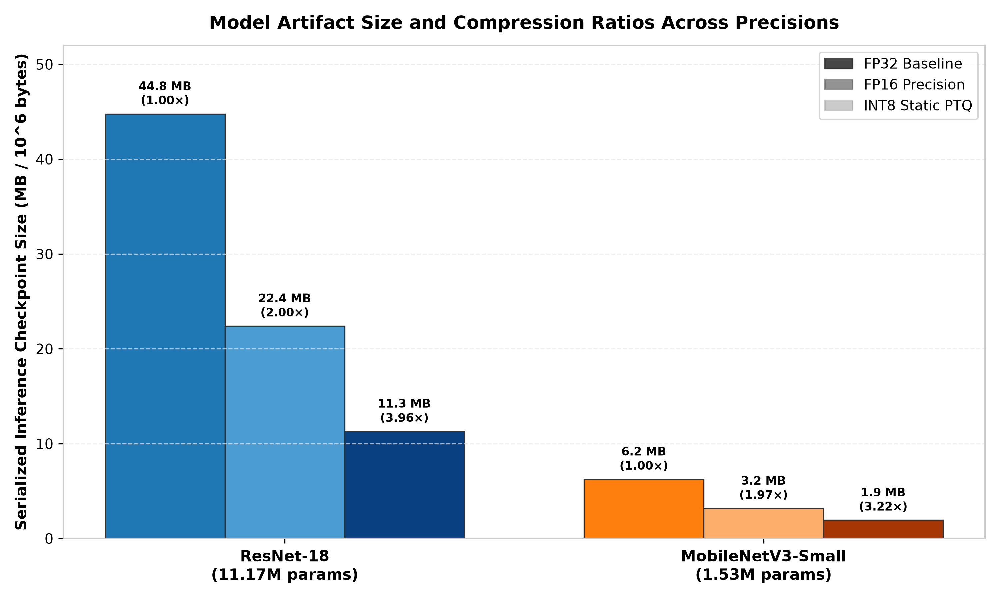
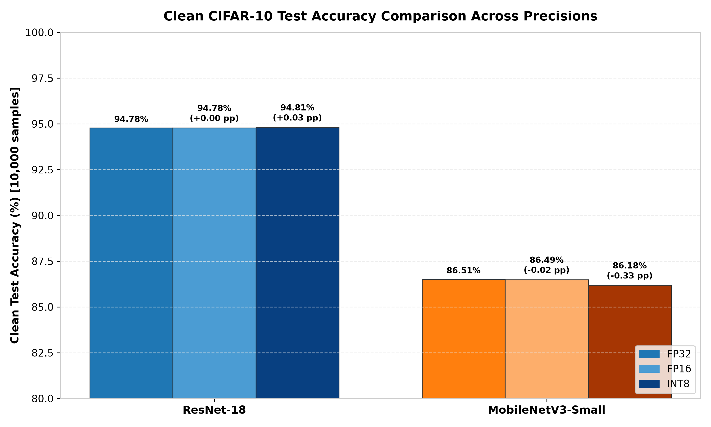
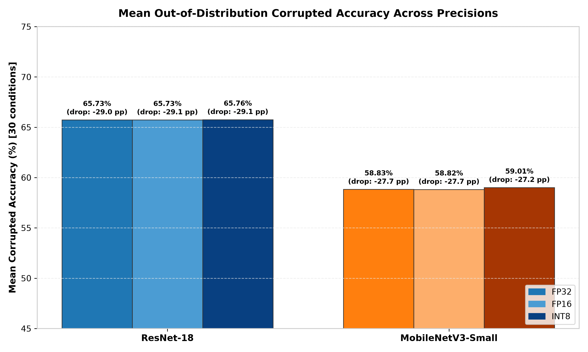
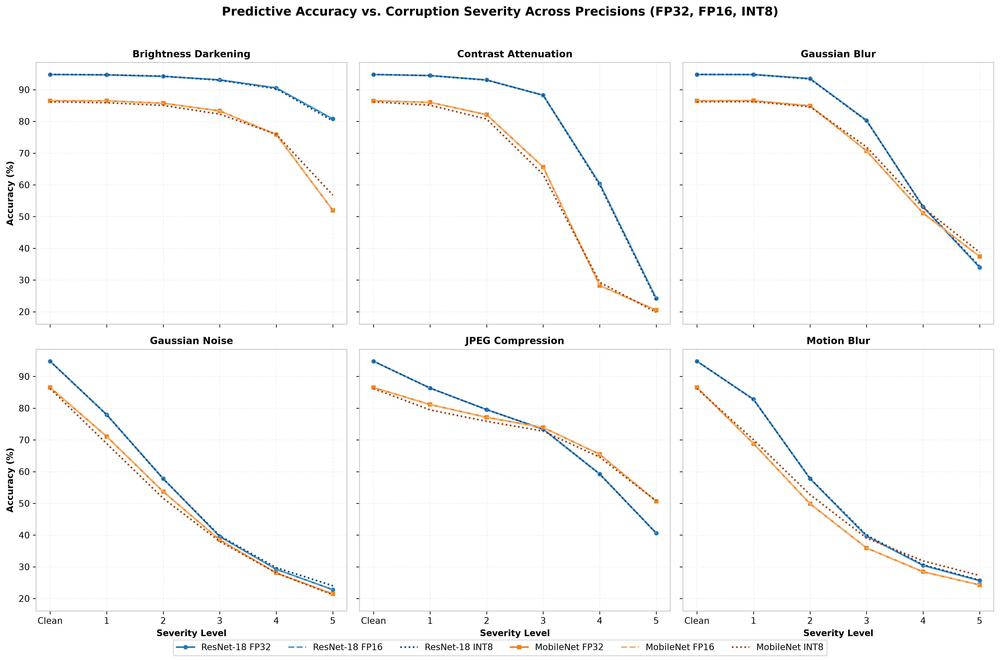
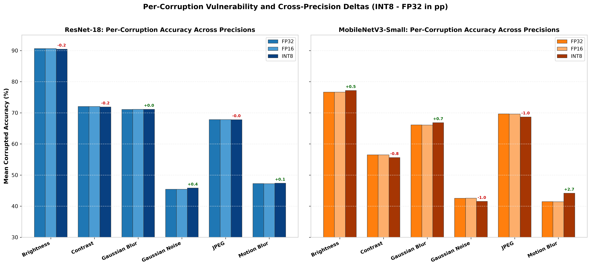
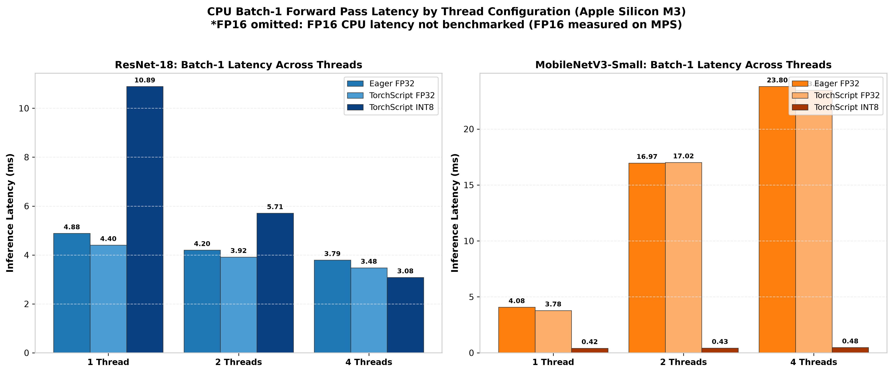
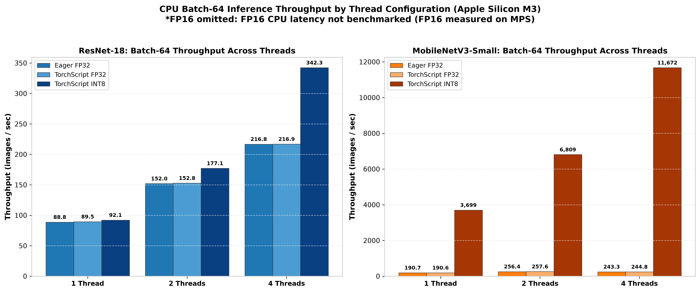
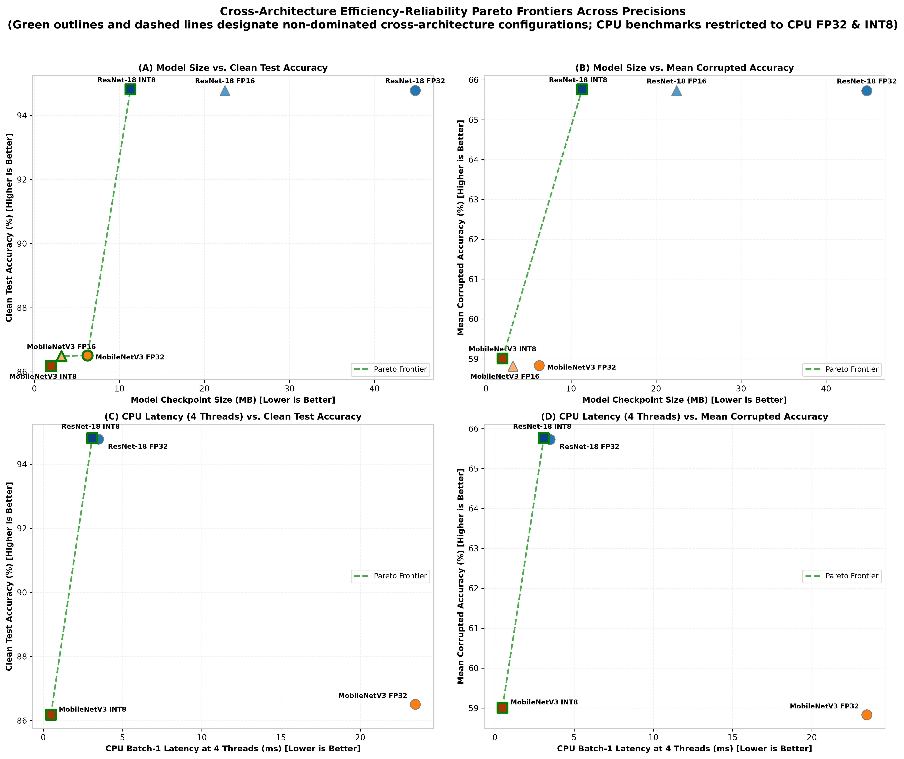

# Cross-Precision Efficiency–Reliability Analysis: FP32, FP16, and INT8 Under Environmental Corruptions

**Project**: Edge Vision Reliability Lab  
**Author**: Sushant Yadav  
**Document Status**: Final Research Report (Task 5.4)  
**Host Architecture**: Apple MacBook Pro (Apple M3, 8-core CPU, 8 GB Unified Memory)  
**Operating System**: macOS 27.0 (Darwin 27.0.0, arm64)  
**Runtime Environment**: Python 3.12.16, PyTorch 2.15.0, Torchvision 0.29.2  
**Date**: November 7, 2026  

---

## 1. Executive Summary

This study presents a systematic empirical evaluation of precision reduction—spanning 32-bit floating-point (FP32), 16-bit floating-point (FP16), and 8-bit post-training static integer quantization (INT8)—across two distinct computer vision architectures: the dense residual baseline **ResNet-18** (11.17M parameters) and the compact inverted-residual architecture **MobileNetV3-Small** (1.53M parameters).

### Core Research Question
> *"How much can we compress a computer vision model before it becomes unreliable under realistic image degradation, and what trade-offs exist between model size, inference latency, resource consumption, and predictive reliability?"*

### Key Findings
1. **Clean Accuracy Resilience**:
   - Compressing to **FP16** incurs virtually zero degradation for both architectures: ResNet-18 maintains identical clean top-1 accuracy (**94.78%**, 99.99% prediction concordance), while MobileNetV3-Small drops by merely **0.02 percentage points (pp)** (86.51% $\rightarrow$ **86.49%**, 99.94% concordance).
   - Post-Training Static Quantization (**INT8**) introduces minimal perturbation on clean inputs: ResNet-18 exhibits a slight gain of **+0.03 pp** (94.78% $\rightarrow$ **94.81%**, 99.64% concordance), while MobileNetV3-Small drops by **-0.33 pp** (86.51% $\rightarrow$ **86.18%**, 95.47% concordance). Observed differences are single-seed results; statistical significance has not been established for small accuracy variations.
2. **Robustness Under Physical and Digital Corruptions**:
   - Across 30 corrupted test conditions (6 corruptions $\times$ 5 severities, 10,000 samples each), mean corrupted accuracy is remarkably stable across precision levels.
   - For **ResNet-18**, mean corrupted accuracy is **65.73%** in FP32, **65.73%** in FP16, and **65.76%** in INT8 (mean accuracy drops of 29.05 pp across all three).
   - For **MobileNetV3-Small**, mean corrupted accuracy is **58.83%** in FP32, **58.82%** in FP16, and **59.01%** in INT8 (mean accuracy drops of 27.68 pp in FP32 vs. 27.17 pp in INT8).
   - However, individual corruption profiles diverge under INT8: MobileNetV3-Small exhibits localized degradation under high-frequency and contrast-sensitive corruptions (`gaussian_noise` -1.01 pp, `contrast` -0.85 pp, `jpeg_compression` -0.98 pp), offset by minor gains under heavy blur (`motion_blur` +2.71 pp, `gaussian_blur` +0.74 pp).
3. **Artifact Size & Compression Ratios**:
   - **ResNet-18**: FP32 (44.78 MB) $\rightarrow$ FP16 (22.41 MB, **2.00×**, 49.95% reduction) $\rightarrow$ INT8 (11.30 MB, **3.96×**, 74.77% reduction).
   - **MobileNetV3-Small**: FP32 (6.25 MB) $\rightarrow$ FP16 (3.17 MB, **1.97×**, 49.29% reduction) $\rightarrow$ INT8 (1.94 MB, **3.22×**, 68.92% reduction). MobileNet achieves a 3.22× compression ratio (rather than the idealized 4.0× payload reduction); floating-point graph fallbacks and serialization container overhead may contribute to this ratio.
4. **Isolated-Process CPU Microbenchmarks**:
   - Under child-process isolation (Task 5.3C), MobileNetV3-Small INT8 delivers a **49.09×** batch-1 latency speedup relative to TorchScript FP32 under 4 threads (0.48 ms vs. 23.47 ms) and a **9.09×** latency speedup under 1 thread (0.42 ms vs. 3.78 ms).
   - ResNet-18 INT8 exhibits latency speedups at 4 threads (**1.13×** at batch 1: 3.08 ms vs. 3.48 ms; **1.58×** at batch 64: 186.97 ms vs. 295.06 ms). However, under a single thread, ResNet-18 INT8 executes in 10.89 ms, which is **2.47× slower** than FP32 (4.40 ms); the microarchitectural or runtime mechanism responsible for this single-thread difference was not isolated.
5. **Efficiency–Reliability Pareto Frontier**:
   - On the multi-objective trade-off between **Model Size** and **Mean Corrupted Accuracy**, only **INT8 configurations** define the Pareto frontier: `MobileNetV3-Small INT8` (1.94 MB, 59.01% corrupted accuracy) for ultra-compact edge nodes, and `ResNet-18 INT8` (11.30 MB, 65.76% corrupted accuracy) for safety-critical tasks. All FP32 and FP16 models are strictly dominated on this plane.
   - On the trade-off between **Single-Thread CPU Latency** and **Accuracy**, `ResNet-18 FP32` enters the Pareto frontier because it executes in 4.40 ms (vs. 10.89 ms for INT8) while maintaining 94.78% clean accuracy and 65.73% corrupted accuracy.

---

## 2. Experimental Setup and Source of Truth

### Hardware and Runtime Environment
All experiments were executed on an Apple MacBook Pro with the following environment:
- **Processor**: Apple M3 (8-core CPU: 4 performance cores + 4 efficiency cores).
- **Memory**: 8 GB unified memory.
- **Operating System**: macOS 27.0 (Darwin 27.0.0, arm64).
- **Software Stack**: Python 3.12.16, PyTorch 2.15.0, Torchvision 0.29.2.
- **Quantization Backend**: PyTorch `qnnpack` engine for ARM64 architecture.

### Model Architectures & Adaptation
1. **ResNet-18 (`resnet18_cifar`)**:
   - Adapted for CIFAR-10 $32 \times 32$ inputs: replaced initial $7 \times 7$ stride-2 convolution with a $3 \times 3$ stride-1 convolution; removed max-pooling layer; adjusted final linear classifier to 10 classes.
   - Total Parameters: **11,173,962** (all trainable). Buffers: 9,620 (running mean/variance + batch counters). Total state-dict elements: **11,183,582**.
2. **MobileNetV3-Small (`mobilenet_v3_small_cifar`)**:
   - Adapted for CIFAR-10 $32 \times 32$ inputs: adjusted first conv stride to 1; customized inverted bottleneck expansion channels and squeeze-and-excitation layers; 10-class linear projection head.
   - Total Parameters: **1,528,106** (all trainable). Buffers: 12,146. Total state-dict elements: **1,540,252**.

### Baseline Training Infrastructure
Both models were trained from scratch for 100 epochs on Apple Silicon MPS using fixed seed `42`:
- Optimizer: SGD with momentum 0.9, weight decay $5 \times 10^{-4}$, initial learning rate 0.1.
- Learning Rate Schedule: `CosineAnnealingLR` decaying to 0 across 100 epochs.
- Data Augmentation: Random crop ($32 \times 32$, padding 4) and Random Horizontal Flip ($p=0.5$).
- Data Split: Deterministic, stratified split of CIFAR-10 training set into 45,000 training and 5,000 validation images; 10,000 held-out test images strictly isolated until evaluation.

### Precision Variants & Quantization Methodology
1. **FP32**: Full-precision 32-bit float baseline exported from training checkpoints to standalone inference state dictionaries (`checkpoints_inference_fp32/`) and TorchScript traces.
2. **FP16**: Half-precision 16-bit float converted via strict parameter casting (`model.half()`), evaluated on Apple Silicon MPS.
3. **INT8 (Static PTQ)**: Post-Training Static Quantization implemented via PyTorch FX Graph Mode (`torch.ao.quantization.quantize_fx`):
   - Backend Engine: `qnnpack`.
   - Calibration: 1,000 unaugmented clean CIFAR-10 training images (batches of 32, seed 42) through `prepare_fx`.
   - Activation & Weight Quantization: Histogram/MinMax observers mapping weights to `qint8` and activations to `quint8`.
   - Residual Connections: MobileNetV3-Small retains floating-point addition nodes for unquantized residual paths. Exported via `torch.jit.trace` to `checkpoints_int8/`.

### Robustness Evaluation Protocol
- **Evaluation Suite**: 31 experimental conditions per model (1 clean baseline + 6 corruption types $\times$ 5 severity levels).
- **Corruptions**: Gaussian Noise, Gaussian Blur, Motion Blur, Brightness Darkening, Contrast Attenuation, and JPEG Compression Artifacts.
- **Sample Allocation**: Exactly 10,000 test samples per condition, evaluated under shared-batch identical presentation with deterministic SHA-256 seeding.
- **Evaluation Total**: 31 conditions $\times$ 10,000 samples $\times$ 2 models = **620,000 forward passes per precision tier** (totaling 1,860,000 predictions across the full project).

---

## 3. Model Size and Storage Compression Analysis

Model artifact storage was analyzed across theoretical parameter budgets, state-dict tensor storage, and serialized on-disk inference artifacts.

```
Idealized Parameter Payload = Parameters × Precision Bytes (4 for FP32, 2 for FP16, 1 for INT8)
Compression Ratio = FP32 Serialized Size / Compressed Serialized Size
Size Reduction (%) = (1 - Compressed Serialized Size / FP32 Serialized Size) × 100
```

### Table 1: Model Storage and Compression Summary Across Precisions

| Architecture | Precision | Total Parameters | Idealized Parameter Payload (MiB) | Idealized Parameter Payload (MB) | Serialized Artifact (Bytes) | Serialized Artifact (MiB) | Serialized Artifact (MB) | Compression Ratio vs. FP32 | Size Reduction vs. FP32 (%) |
|:---|:---:|:---:|:---:|:---:|:---:|:---:|:---:|:---:|:---:|
| **ResNet-18** | **FP32** | 11,173,962 | 42.63 MiB | 44.70 MB | 44,775,947 | 42.70 MiB | 44.78 MB | 1.000× | 0.00% |
| **ResNet-18** | **FP16** | 11,173,962 | 21.31 MiB | 22.35 MB | 22,408,843 | 21.37 MiB | 22.41 MB | **1.998×** | **49.95%** |
| **ResNet-18** | **INT8** | 11,173,962 | 10.66 MiB | 11.17 MB | 11,296,669 | 10.77 MiB | 11.30 MB | **3.964×** | **74.77%** |
| **MobileNetV3-Small** | **FP32** | 1,528,106 | 5.83 MiB | 6.11 MB | 6,249,979 | 5.96 MiB | 6.25 MB | 1.000× | 0.00% |
| **MobileNetV3-Small** | **FP16** | 1,528,106 | 2.91 MiB | 3.06 MB | 3,169,467 | 3.02 MiB | 3.17 MB | **1.972×** | **49.29%** |
| **MobileNetV3-Small** | **INT8** | 1,528,106 | 1.46 MiB | 1.53 MB | 1,942,499 | 1.85 MiB | 1.94 MB | **3.218×** | **68.92%** |

*Note on Theoretical vs. Serialized Storage*: For INT8, the idealized parameter payload represents an idealized 8-bit parameter payload ($parameters \times 1$ byte = 11.17 MB for ResNet, 1.53 MB for MobileNet), not the actual serialized hybrid quantized model artifact. Actual serialized inference checkpoints isolate all model weights, quantization scaling parameters, and buffers, and are reported separately.

### Storage Analysis Observations
1. **Linear Halving in FP16**: Both architectures achieve near-perfect 2.0× compression under FP16 (1.998× for ResNet-18, 1.972× for MobileNetV3-Small). The small deviation from 2.000× is attributable to fixed TorchScript/pickle metadata overhead and integer batch tracking buffers (int64) that are not cast to half precision.
2. **Architecture Disparity in INT8 Compression**:
   - ResNet-18 scales from 44.78 MB down to 11.30 MB (**3.964× compression**, 74.77% reduction), approaching the theoretical 4.0× limit. Dense convolutional blocks quantize uniformly across weight matrices and activation observers.
   - MobileNetV3-Small serialized inference size decreases from 6.25 MB to 1.94 MB (**3.218× compression**, 68.92% reduction). While factors such as floating-point graph nodes (including residual addition fallbacks), per-channel quantization scale and zero-point parameters, unquantized activation layers, and container serialization overhead may contribute to the compression ratio being lower than an idealized 4.0× factor, the individual contributions of these factors were not isolated.
3. **Training Checkpoints vs. Inference Artifacts**:
   - The original training checkpoints were 89.51 MB for ResNet-18 and 12.42 MB for MobileNetV3-Small. These larger files contain full SGD momentum buffers (4 bytes per parameter) and epoch scheduler state.
   - In contrast, the dedicated inference checkpoints isolate model weights and buffers, eliminating training optimizer bloat.



---

## 4. Clean Predictive Reliability Across Precisions

Predictive accuracy and decision consistency on the 10,000 clean CIFAR-10 test set were evaluated across all precision levels.

```
Accuracy Difference (pp) = Precision Accuracy (%) - FP32 Baseline Accuracy (%)
Concordance (%) = (Number of Identical Predictions / 10,000) × 100
```

### Table 2: Clean Test Set Predictive Reliability and Concordance

| Architecture | Precision | Clean Accuracy (%) | Cross-Entropy Loss | Correct Samples (/10,000) | Incorrect Samples (/10,000) | Accuracy Diff vs. FP32 (pp) | Prediction Concordance (%) | Changed Predictions (/10,000) |
|:---|:---:|:---:|:---:|:---:|:---:|:---:|:---:|:---:|
| **ResNet-18** | **FP32** | 94.78% | 0.2003 | 9,478 | 522 | 0.00 pp | 100.00% | 0 |
| **ResNet-18** | **FP16** | 94.78% | 0.2003 | 9,478 | 522 | 0.00 pp | **99.99%** | 1 |
| **ResNet-18** | **INT8** | 94.81% | 0.2003 | 9,481 | 519 | **+0.03 pp** | **99.64%** | 36 |
| **MobileNetV3-Small** | **FP32** | 86.51% | 0.3896 | 8,651 | 1,349 | 0.00 pp | 100.00% | 0 |
| **MobileNetV3-Small** | **FP16** | 86.49% | 0.3896 | 8,649 | 1,351 | **-0.02 pp** | **99.94%** | 6 |
| **MobileNetV3-Small** | **INT8** | 86.18% | 0.4117 | 8,618 | 1,382 | **-0.33 pp** | **95.47%** | 453 |

### Clean Evaluation Findings
1. **FP16 Near-Identity**: FP16 produces near-identical predictions to FP32. On ResNet-18, only 1 sample out of 10,000 flips classification label (concordance 99.99%). On MobileNetV3-Small, only 6 samples flip (concordance 99.94%), causing an imperceptible 0.02 pp drop.
2. **INT8 Preservation**:
   - On ResNet-18, INT8 quantization yields an accuracy of 94.81% (+0.03 pp over FP32) with 99.64% concordance (36 label changes). This confirms that overparameterized residual networks are highly resilient to 8-bit weight and activation quantization.
   - On MobileNetV3-Small, INT8 quantization incurs a slight penalty of -0.33 pp (86.51% $\rightarrow$ 86.18%), with loss increasing from 0.3896 to 0.4117. Prediction concordance is 95.47%, with 453 samples flipping decisions. This demonstrates that compact architectures with smaller channel counts exhibit higher sensitivity to quantization rounding noise.
3. **Statistical Significance Caveat**: These measurements represent observed single-seed evaluation results on the held-out test set. Because experiments were conducted with a single training seed (seed 42) and without repeated trials, statistical significance has not been established for small accuracy differences (such as the +0.03 pp shift in ResNet-18 or the -0.33 pp shift in MobileNetV3-Small). These differences should be interpreted strictly as observed empirical values rather than established architectural effects.



---

## 5. Corruption Robustness Analysis

Robustness was benchmarked across 30 corrupted conditions per model. Each condition includes 10,000 images generated using deterministic pre-normalization operations.

```
Mean Corrupted Accuracy = Mean(Accuracy across all 30 corrupted conditions)
Mean Accuracy Drop (pp) = Clean Accuracy (%) - Mean Corrupted Accuracy (%)
Mean Relative Accuracy Drop = (Clean Accuracy - Mean Corrupted Accuracy) / Clean Accuracy
```

### Table 3: Overall Robustness and Degradation Metrics

| Architecture | Precision | Clean Accuracy (%) | Mean Corrupted Accuracy (%) | Mean Accuracy Drop (pp) | Mean Relative Accuracy Drop | Corrupted Acc Diff vs. FP32 (pp) |
|:---|:---:|:---:|:---:|:---:|:---:|:---:|
| **ResNet-18** | **FP32** | 94.78% | 65.73% | 29.049 pp | 0.3065 | 0.00 pp |
| **ResNet-18** | **FP16** | 94.78% | 65.73% | 29.051 pp | 0.3065 | 0.00 pp |
| **ResNet-18** | **INT8** | 94.81% | 65.76% | 29.052 pp | 0.3064 | **+0.03 pp** |
| **MobileNetV3-Small** | **FP32** | 86.51% | 58.83% | 27.684 pp | 0.3200 | 0.00 pp |
| **MobileNetV3-Small** | **FP16** | 86.49% | 58.82% | 27.670 pp | 0.3199 | -0.01 pp |
| **MobileNetV3-Small** | **INT8** | 86.18% | 59.01% | 27.167 pp | 0.3152 | **+0.19 pp** |



### Table 4: Per-Corruption Accuracy Across Precisions (%)

| Architecture | Corruption Type | FP32 Mean Acc (%) | FP16 Mean Acc (%) | INT8 Mean Acc (%) | INT8 vs. FP32 Delta (pp) | INT8 vs. FP16 Delta (pp) |
|:---|:---|:---:|:---:|:---:|:---:|:---:|
| **ResNet-18** | Brightness | 90.66% | 90.66% | 90.48% | -0.18 pp | -0.17 pp |
| **ResNet-18** | Contrast | 72.06% | 72.06% | 71.89% | -0.17 pp | -0.17 pp |
| **ResNet-18** | Gaussian Blur | 71.11% | 71.13% | 71.15% | +0.04 pp | +0.03 pp |
| **ResNet-18** | Gaussian Noise | 45.46% | 45.47% | 45.83% | **+0.37 pp** | +0.36 pp |
| **ResNet-18** | JPEG Compression | 67.83% | 67.82% | 67.80% | -0.02 pp | -0.02 pp |
| **ResNet-18** | Motion Blur | 47.27% | 47.25% | 47.39% | +0.12 pp | +0.14 pp |
| **MobileNetV3-Small** | Brightness | 76.68% | 76.66% | 77.18% | +0.51 pp | +0.52 pp |
| **MobileNetV3-Small** | Contrast | 56.49% | 56.50% | 55.64% | **-0.85 pp** | -0.86 pp |
| **MobileNetV3-Small** | Gaussian Blur | 66.12% | 66.10% | 66.86% | +0.74 pp | +0.76 pp |
| **MobileNetV3-Small** | Gaussian Noise | 42.54% | 42.57% | 41.54% | **-1.01 pp** | -1.04 pp |
| **MobileNetV3-Small** | JPEG Compression | 69.66% | 69.64% | 68.68% | **-0.98 pp** | -0.96 pp |
| **MobileNetV3-Small** | Motion Blur | 41.47% | 41.44% | 44.18% | **+2.71 pp** | +2.74 pp |

### Table 5: Per-Severity Accuracy Across Precisions (%)

| Architecture | Severity Level | FP32 Mean Acc (%) | FP16 Mean Acc (%) | INT8 Mean Acc (%) | INT8 vs. FP32 Delta (pp) |
|:---|:---:|:---:|:---:|:---:|:---:|
| **ResNet-18** | Severity 1 | 88.50% | 88.50% | 88.48% | -0.02 pp |
| **ResNet-18** | Severity 2 | 79.31% | 79.32% | 79.29% | -0.02 pp |
| **ResNet-18** | Severity 3 | 69.03% | 69.03% | 69.08% | +0.04 pp |
| **ResNet-18** | Severity 4 | 53.81% | 53.80% | 53.83% | +0.02 pp |
| **ResNet-18** | Severity 5 | 38.00% | 37.99% | 38.11% | +0.12 pp |
| **MobileNetV3-Small** | Severity 1 | 80.01% | 80.01% | 79.26% | -0.76 pp |
| **MobileNetV3-Small** | Severity 2 | 72.23% | 72.24% | 71.76% | -0.47 pp |
| **MobileNetV3-Small** | Severity 3 | 61.32% | 61.31% | 61.22% | -0.11 pp |
| **MobileNetV3-Small** | Severity 4 | 46.18% | 46.17% | 47.08% | **+0.90 pp** |
| **MobileNetV3-Small** | Severity 5 | 34.38% | 34.38% | 35.75% | **+1.37 pp** |




### Key Observations on Robustness
1. **Preservation of Negative Drops**: Under mild corruptions (e.g., Brightness Severity 1), both architectures exhibit negative accuracy drops (e.g., ResNet-18 INT8 reaches 94.87% vs. 94.81% clean, drop = -0.06 pp). These negative drops are strictly preserved in raw calculations and summaries.
2. **ResNet-18 Invariance to Precision**: ResNet-18 shows nearly zero robustness sensitivity to precision across all corruptions and severities. Maximum divergence from FP32 is +0.37 pp (Gaussian Noise) and -0.18 pp (Brightness), indicating that 11.17M parameter capacity confers strong numerical stability.
3. **MobileNetV3 Divergence under INT8**: While overall mean corrupted accuracy rises slightly (+0.19 pp from 58.83% to 59.01%), the individual corruption responses bifurcate:
   - MobileNet degrades under additive high-frequency noise and compression: Gaussian noise drops by **-1.01 pp**, contrast drops by **-0.85 pp**, and JPEG compression drops by **-0.98 pp**.
   - Conversely, MobileNet gains under extreme blur: motion blur increases by **+2.71 pp** (41.47% $\rightarrow$ 44.18%) and Gaussian blur increases by **+0.74 pp** (66.12% $\rightarrow$ 66.86%).
   - Across severities, INT8 underperforms FP32 at mild severities 1–3 (-0.76 pp to -0.11 pp), but slightly outperforms FP32 at severe corruptions 4–5 (+0.90 pp to +1.37 pp).
   - In accordance with methodological standards, these divergences are reported as empirical observations; speculative claims regarding activation clipping or threshold noise are avoided.

---

## 6. CPU Inference Performance Analysis

CPU inference latency and throughput were evaluated using the verified **isolated-process benchmark runner** (Task 5.3C). Every configuration was measured in an independent OS child process with thread counts initialized strictly prior to model execution.

*Note on FP16*: FP16 CPU inference latency was not benchmarked in this project. FP16 evaluation was conducted on Apple Silicon MPS; therefore, CPU latency and throughput metrics are reported as **N/A** for FP16 to avoid conflating different execution devices.

### Table 6: CPU Latency and Throughput Across Thread Configurations (Apple M3)

| Intra-op Threads | Architecture | Precision Variant | Batch 1 Mean Latency (ms) | Batch 1 Median Latency (ms) | Batch 1 P95 Latency (ms) | Batch 64 Mean Latency (ms) | Batch 64 Throughput (img/s) |
|:---:|:---|:---|:---:|:---:|:---:|:---:|:---:|
| **1 Thread** | ResNet-18 | Eager FP32 | 4.884 ms | 4.720 ms | 5.127 ms | 720.644 ms | 88.8 img/s |
| **1 Thread** | ResNet-18 | TorchScript FP32 | 4.404 ms | 4.412 ms | 4.507 ms | 715.187 ms | 89.5 img/s |
| **1 Thread** | ResNet-18 | FP16 | *N/A (MPS only)* | *N/A* | *N/A* | *N/A* | *N/A* |
| **1 Thread** | ResNet-18 | TorchScript INT8 | 10.889 ms | 10.887 ms | 11.004 ms | 695.087 ms | 92.1 img/s |
| **1 Thread** | MobileNetV3-Small | Eager FP32 | 4.076 ms | 4.074 ms | 4.214 ms | 335.587 ms | 190.7 img/s |
| **1 Thread** | MobileNetV3-Small | TorchScript FP32 | 3.782 ms | 3.770 ms | 3.888 ms | 335.784 ms | 190.6 img/s |
| **1 Thread** | MobileNetV3-Small | FP16 | *N/A (MPS only)* | *N/A* | *N/A* | *N/A* | *N/A* |
| **1 Thread** | MobileNetV3-Small | TorchScript INT8 | **0.416 ms** | **0.411 ms** | **0.453 ms** | **17.306 ms** | **3,699.4 img/s** |
| **2 Threads** | ResNet-18 | Eager FP32 | 4.200 ms | 4.154 ms | 4.573 ms | 421.108 ms | 152.0 img/s |
| **2 Threads** | ResNet-18 | TorchScript FP32 | 3.916 ms | 3.911 ms | 4.010 ms | 418.882 ms | 152.8 img/s |
| **2 Threads** | ResNet-18 | FP16 | *N/A (MPS only)* | *N/A* | *N/A* | *N/A* | *N/A* |
| **2 Threads** | ResNet-18 | TorchScript INT8 | 5.709 ms | 5.703 ms | 5.805 ms | 361.346 ms | 177.1 img/s |
| **2 Threads** | MobileNetV3-Small | Eager FP32 | 16.966 ms | 16.966 ms | 17.142 ms | 249.585 ms | 256.4 img/s |
| **2 Threads** | MobileNetV3-Small | TorchScript FP32 | 17.015 ms | 16.881 ms | 17.071 ms | 248.442 ms | 257.6 img/s |
| **2 Threads** | MobileNetV3-Small | FP16 | *N/A (MPS only)* | *N/A* | *N/A* | *N/A* | *N/A* |
| **2 Threads** | MobileNetV3-Small | TorchScript INT8 | **0.429 ms** | **0.427 ms** | **0.457 ms** | **9.399 ms** | **6,808.9 img/s** |
| **4 Threads** | ResNet-18 | Eager FP32 | 3.792 ms | 3.726 ms | 4.304 ms | 295.118 ms | 216.8 img/s |
| **4 Threads** | ResNet-18 | TorchScript FP32 | 3.477 ms | 3.463 ms | 3.595 ms | 295.056 ms | 216.9 img/s |
| **4 Threads** | ResNet-18 | FP16 | *N/A (MPS only)* | *N/A* | *N/A* | *N/A* | *N/A* |
| **4 Threads** | ResNet-18 | TorchScript INT8 | **3.084 ms** | **3.048 ms** | **3.187 ms** | **186.973 ms** | **342.3 img/s** |
| **4 Threads** | MobileNetV3-Small | Eager FP32 | 23.801 ms | 23.956 ms | 24.477 ms | 263.021 ms | 243.3 img/s |
| **4 Threads** | MobileNetV3-Small | TorchScript FP32 | 23.466 ms | 23.295 | 24.425 ms | 261.490 ms | 244.8 img/s |
| **4 Threads** | MobileNetV3-Small | FP16 | *N/A (MPS only)* | *N/A* | *N/A* | *N/A* | *N/A* |
| **4 Threads** | MobileNetV3-Small | TorchScript INT8 | **0.478 ms** | **0.469 ms** | **0.541 ms** | **5.483 ms** | **11,672.4 img/s** |




### Performance Findings and Discussion
1. **Resolution of Single-Process Thread Pollution**:
   - In Task 5.3B, sequencing thread tests in a single continuous process caused ResNet-18 batch 64 under 4 threads to execute at ~729 ms due to OpenMP thread-pool lock-in from an earlier single-thread call.
   - Under the isolated child-process architecture, ResNet-18 batch 64 under 4 threads executes at **295.06 ms** (TorchScript FP32) and **186.97 ms** (TorchScript INT8), confirming that the earlier slowdown was an experimental artifact.
2. **MobileNetV3 Scaling Across Threads**:
   - MobileNetV3-Small FP32 batch-1 latency increases monotonically with thread count: 3.78 ms (1 thread) $\rightarrow$ 17.02 ms (2 threads) $\rightarrow$ 23.47 ms (4 threads).
   - In contrast, MobileNetV3-Small INT8 batch-1 latency remains flat across thread counts: 0.42 ms (1 thread) $\rightarrow$ 0.43 ms (2 threads) $\rightarrow$ 0.48 ms (4 threads).
   - Consequently, the measured latency speedup of INT8 vs. TorchScript FP32 at batch 1 is **9.09×** under 1 thread, **39.66×** under 2 threads, and **49.09×** under 4 threads. At batch 64, INT8 throughput reaches **11,672.4 img/s** under 4 threads (a **47.68× improvement** over FP32's 244.8 img/s).
3. **ResNet-18 Single-Thread Latency Penalty**:
   - At 4 threads, ResNet-18 INT8 provides a positive speedup over FP32: **1.13×** at batch 1 (3.08 ms vs. 3.48 ms) and **1.58×** at batch 64 (186.97 ms vs. 295.06 ms).
   - However, at 1 thread, ResNet-18 INT8 takes **10.89 ms**, which is **2.47× slower** than TorchScript FP32 (4.40 ms). The underlying microarchitectural or runtime mechanism responsible for this single-thread latency disparity was not isolated in these experiments.

---

## 7. Efficiency–Reliability Trade-Offs and Pareto Analysis

To identify optimal deployment candidates, a multi-objective Pareto analysis was executed.

### Pareto Dominance Criterion (Mixed Objectives)
For $K$ objectives with individual optimization directions (minimization or maximization), configuration $A$ strictly dominates configuration $B$ ($A \succ B$) if and only if:
1. For every objective $k \in \{1, \dots, K\}$, $A$ is at least as good as $B$:
   - For minimization objectives: $\text{val}_A(k) \le \text{val}_B(k)$
   - For maximization objectives: $\text{val}_A(k) \ge \text{val}_B(k)$
2. AND for at least one objective $j \in \{1, \dots, K\}$, $A$ is strictly better than $B$:
   - For minimization objectives: $\text{val}_A(j) < \text{val}_B(j)$
   - For maximization objectives: $\text{val}_A(j) > \text{val}_B(j)$

A configuration is **Pareto-efficient (non-dominated)** within an evaluated candidate set if no other configuration in that set strictly dominates it. Comparisons are evaluated both within individual architectures and across architectures. All CPU latency comparisons are strictly restricted to measured CPU variants (FP32 and INT8); MPS FP16 measurements are not mixed into CPU Pareto planes.

### Table 7A: Within-Architecture Pareto Frontiers

| Architecture | Trade-Off Objective Plane | Objective 1 (Minimization) | Objective 2 (Maximization) | Within-Architecture Pareto Frontier | Dominated Configurations (Within Architecture) | Dominance Insights |
|:---|:---|:---|:---|:---|:---|:---|
| **ResNet-18** | Size vs. Clean Acc | Model Size (MB) | Clean Accuracy (%) | **ResNet-18 INT8** (11.30 MB, 94.81%) | ResNet-18 FP16 (22.41 MB, 94.78%)<br>ResNet-18 FP32 (44.78 MB, 94.78%) | INT8 strictly dominates FP16 and FP32 (smaller size and higher clean accuracy). |
| **ResNet-18** | Size vs. Corrupted Acc | Model Size (MB) | Mean Corrupted Acc (%) | **ResNet-18 INT8** (11.30 MB, 65.76%) | ResNet-18 FP16 (22.41 MB, 65.73%)<br>ResNet-18 FP32 (44.78 MB, 65.73%) | INT8 strictly dominates FP16 and FP32 on corrupted accuracy. |
| **ResNet-18** | CPU Latency (4 Th) vs. Clean Acc | CPU Batch 1 Latency (ms) | Clean Accuracy (%) | **ResNet-18 INT8** (3.08 ms, 94.81%) | ResNet-18 FP32 (3.48 ms, 94.78%) | INT8 strictly dominates FP32 at 4 threads (faster and higher accuracy). |
| **ResNet-18** | CPU Latency (4 Th) vs. Corrupted Acc | CPU Batch 1 Latency (ms) | Mean Corrupted Acc (%) | **ResNet-18 INT8** (3.08 ms, 65.76%) | ResNet-18 FP32 (3.48 ms, 65.73%) | INT8 strictly dominates FP32 at 4 threads. |
| **ResNet-18** | CPU Latency (2 Th) vs. Clean Acc | CPU Batch 1 Latency (ms) | Clean Accuracy (%) | 1. **ResNet-18 FP32** (3.92 ms, 94.78%)<br>2. **ResNet-18 INT8** (5.71 ms, 94.81%) | *(None dominated)* | **Trade-off exists at 2 threads.** FP32 is 1.46× faster; INT8 observed clean accuracy is 94.81% vs. 94.78%. |
| **ResNet-18** | CPU Latency (2 Th) vs. Corrupted Acc | CPU Batch 1 Latency (ms) | Mean Corrupted Acc (%) | 1. **ResNet-18 FP32** (3.92 ms, 65.73%)<br>2. **ResNet-18 INT8** (5.71 ms, 65.76%) | *(None dominated)* | **Trade-off exists at 2 threads.** FP32 is faster (3.92 ms vs. 5.71 ms); INT8 observed corrupted accuracy is 65.76% vs. 65.73%. |
| **ResNet-18** | CPU Latency (1 Th) vs. Clean Acc | CPU Batch 1 Latency (ms) | Clean Accuracy (%) | 1. **ResNet-18 FP32** (4.40 ms, 94.78%)<br>2. **ResNet-18 INT8** (10.89 ms, 94.81%) | *(None dominated)* | **Trade-off exists at 1 thread.** FP32 is 2.47× faster (4.40 ms vs. 10.89 ms); INT8 has observed clean accuracy of 94.81% vs. 94.78%. |
| **ResNet-18** | CPU Latency (1 Th) vs. Corrupted Acc | CPU Batch 1 Latency (ms) | Mean Corrupted Acc (%) | 1. **ResNet-18 FP32** (4.40 ms, 65.73%)<br>2. **ResNet-18 INT8** (10.89 ms, 65.76%) | *(None dominated)* | **Trade-off exists at 1 thread.** FP32 delivers near-identical robustness (65.73% vs. 65.76%) in less than half the single-thread latency. |
| **MobileNetV3** | Size vs. Clean Acc | Model Size (MB) | Clean Accuracy (%) | 1. **MobileNetV3 INT8** (1.94 MB, 86.18%)<br>2. **MobileNetV3 FP16** (3.17 MB, 86.49%)<br>3. **MobileNetV3 FP32** (6.25 MB, 86.51%) | *(None dominated)* | Trade-off chain: INT8 offers smallest size (1.94 MB); FP16 provides higher clean accuracy (+0.31 pp); FP32 provides highest clean accuracy (+0.02 pp). |
| **MobileNetV3** | Size vs. Corrupted Acc | Model Size (MB) | Mean Corrupted Acc (%) | **MobileNetV3 INT8** (1.94 MB, 59.01%) | MobileNetV3 FP16 (3.17 MB, 58.82%)<br>MobileNetV3 FP32 (6.25 MB, 58.83%) | INT8 strictly dominates FP16 and FP32 (smaller size and higher corrupted accuracy). |
| **MobileNetV3** | CPU Latency (4 Th) vs. Clean Acc | CPU Batch 1 Latency (ms) | Clean Accuracy (%) | 1. **MobileNetV3 INT8** (0.48 ms, 86.18%)<br>2. **MobileNetV3 FP32** (23.47 ms, 86.51%) | *(None dominated within MobileNet)* | Within MobileNet, FP32 offers a marginal +0.33 pp clean accuracy advantage at the cost of 49× higher latency. |
| **MobileNetV3** | CPU Latency (4 Th) vs. Corrupted Acc | CPU Batch 1 Latency (ms) | Mean Corrupted Acc (%) | **MobileNetV3 INT8** (0.48 ms, 59.01%) | MobileNetV3 FP32 (23.47 ms, 58.83%) | INT8 strictly dominates FP32 on corrupted accuracy (0.48 ms < 23.47 ms and 59.01% > 58.83%). |
| **MobileNetV3** | CPU Latency (2 Th) vs. Clean Acc | CPU Batch 1 Latency (ms) | Clean Accuracy (%) | 1. **MobileNetV3 INT8** (0.43 ms, 86.18%)<br>2. **MobileNetV3 FP32** (17.02 ms, 86.51%) | *(None dominated within MobileNet)* | Within MobileNet, trade-off between 0.43 ms latency and +0.33 pp clean accuracy. |
| **MobileNetV3** | CPU Latency (2 Th) vs. Corrupted Acc | CPU Batch 1 Latency (ms) | Mean Corrupted Acc (%) | **MobileNetV3 INT8** (0.43 ms, 59.01%) | MobileNetV3 FP32 (17.02 ms, 58.83%) | INT8 strictly dominates FP32 on corrupted accuracy (0.43 ms < 17.02 ms and 59.01% > 58.83%). |
| **MobileNetV3** | CPU Latency (1 Th) vs. Clean Acc | CPU Batch 1 Latency (ms) | Clean Accuracy (%) | 1. **MobileNetV3 INT8** (0.42 ms, 86.18%)<br>2. **MobileNetV3 FP32** (3.78 ms, 86.51%) | *(None dominated within MobileNet)* | Within MobileNet, trade-off between 0.42 ms latency and +0.33 pp clean accuracy. |
| **MobileNetV3** | CPU Latency (1 Th) vs. Corrupted Acc | CPU Batch 1 Latency (ms) | Mean Corrupted Acc (%) | **MobileNetV3 INT8** (0.42 ms, 59.01%) | MobileNetV3 FP32 (3.78 ms, 58.83%) | INT8 strictly dominates FP32 on corrupted accuracy (0.42 ms < 3.78 ms and 59.01% > 58.83%). |

### Table 7B: Cross-Architecture Pareto Frontiers

| Trade-Off Objective Plane | Objective 1 (Minimization) | Objective 2 (Maximization) | Cross-Architecture Pareto Frontier | Dominated Configurations (Cross-Architecture) | Cross-Architecture Insights |
|:---|:---|:---|:---|:---|:---|
| **Trade-Off 1: Size vs. Clean Acc** | Model Size (MB) [Min] | Clean Accuracy (%) [Max] | 1. MobileNetV3-Small INT8 (1.94 MB, 86.18%)<br>2. MobileNetV3-Small FP16 (3.17 MB, 86.49%)<br>3. MobileNetV3-Small FP32 (6.25 MB, 86.51%)<br>4. **ResNet-18 INT8** (11.30 MB, 94.81%) | - ResNet-18 FP16 (22.41 MB, 94.78%) [Dominated by ResNet-18 INT8]<br>- ResNet-18 FP32 (44.78 MB, 94.78%) [Dominated by ResNet-18 INT8] | ResNet-18 INT8 strictly dominates ResNet-18 FP16 and FP32. MobileNet variants form the lower-size portion of the frontier. |
| **Trade-Off 2: Size vs. Corrupted Acc** | Model Size (MB) [Min] | Mean Corrupted Acc (%) [Max] | 1. **MobileNetV3-Small INT8** (1.94 MB, 59.01%)<br>2. **ResNet-18 INT8** (11.30 MB, 65.76%) | - MobileNetV3-Small FP16 [Dominated by MobileNet INT8]<br>- MobileNetV3-Small FP32 [Dominated by MobileNet INT8]<br>- ResNet-18 FP16 [Dominated by ResNet-18 INT8]<br>- ResNet-18 FP32 [Dominated by ResNet-18 INT8] | **Only INT8 models exist on this cross-architecture frontier.** All FP32 and FP16 models are strictly dominated on size vs. corrupted accuracy. |
| **Trade-Off 3: Latency (4 Th) vs. Clean Acc** | CPU Batch 1 Latency (ms) [Min] | Clean Accuracy (%) [Max] | 1. MobileNetV3-Small INT8 (0.48 ms, 86.18%)<br>2. **ResNet-18 INT8** (3.08 ms, 94.81%) | - ResNet-18 FP32 (3.48 ms, 94.78%) [Dominated by ResNet-18 INT8]<br>- MobileNetV3-Small FP32 (23.47 ms, 86.51%) [Dominated by ResNet-18 INT8] | At 4 threads, MobileNetV3 FP32 is strictly dominated by ResNet-18 INT8 (ResNet-18 INT8 is 7.6× faster and +8.30 pp more accurate). |
| **Trade-Off 4: Latency (4 Th) vs. Corrupted Acc** | CPU Batch 1 Latency (ms) [Min] | Mean Corrupted Acc (%) [Max] | 1. **MobileNetV3-Small INT8** (0.48 ms, 59.01%)<br>2. **ResNet-18 INT8** (3.08 ms, 65.76%) | - ResNet-18 FP32 (3.48 ms, 65.73%) [Dominated by ResNet-18 INT8]<br>- MobileNetV3-Small FP32 (23.47 ms, 58.83%) [Dominated by ResNet-18 INT8] | Both FP32 models are strictly dominated at 4 threads. |
| **Trade-Off 5: Latency (2 Th) vs. Clean Acc** | CPU Batch 1 Latency (ms) [Min] | Clean Accuracy (%) [Max] | 1. MobileNetV3-Small INT8 (0.43 ms, 86.18%)<br>2. **ResNet-18 FP32** (3.92 ms, 94.78%)<br>3. **ResNet-18 INT8** (5.71 ms, 94.81%) | - MobileNetV3-Small FP32 (17.02 ms, 86.51%) [Dominated by ResNet-18 FP32] | ResNet-18 FP32 strictly dominates MobileNetV3 FP32 (3.92 ms vs. 17.02 ms; 94.78% vs. 86.51%). |
| **Trade-Off 6: Latency (2 Th) vs. Corrupted Acc** | CPU Batch 1 Latency (ms) [Min] | Mean Corrupted Acc (%) [Max] | 1. **MobileNetV3-Small INT8** (0.43 ms, 59.01%)<br>2. **ResNet-18 FP32** (3.92 ms, 65.73%)<br>3. **ResNet-18 INT8** (5.71 ms, 65.76%) | - MobileNetV3-Small FP32 (17.02 ms, 58.83%) [Dominated by MobileNet INT8] | Both ResNet-18 FP32 and MobileNet INT8 dominate MobileNet FP32. |
| **Trade-Off 7: Latency (1 Th) vs. Clean Acc** | CPU Batch 1 Latency (ms) [Min] | Clean Accuracy (%) [Max] | 1. MobileNetV3-Small INT8 (0.42 ms, 86.18%)<br>2. MobileNetV3-Small FP32 (3.78 ms, 86.51%)<br>3. **ResNet-18 FP32** (4.40 ms, 94.78%)<br>4. **ResNet-18 INT8** (10.89 ms, 94.81%) | *(None dominated among evaluated CPU variants)* | **ResNet-18 FP32 enters the cross-architecture Pareto frontier** under 1-thread CPU execution. |
| **Trade-Off 8: Latency (1 Th) vs. Corrupted Acc** | CPU Batch 1 Latency (ms) [Min] | Mean Corrupted Acc (%) [Max] | 1. MobileNetV3-Small INT8 (0.42 ms, 59.01%)<br>2. **ResNet-18 FP32** (4.40 ms, 65.73%)<br>3. **ResNet-18 INT8** (10.89 ms, 65.76%) | - MobileNetV3-Small FP32 (3.78 ms, 58.83%) [Dominated by MobileNet INT8] | ResNet-18 FP32 delivers near-identical robustness (65.73% vs. 65.76%) in less than half the single-thread latency of INT8. |



### Detailed Trade-Off Insights
1. **The Dominance of INT8 on Robustness vs. Storage**:
   - On the plane of (Model Size vs. Mean Corrupted Accuracy), **every FP32 and FP16 model is strictly dominated**.
   - INT8 models achieve equal or superior corrupted accuracy compared to their FP32 counterparts (65.76% vs. 65.73% for ResNet; 59.01% vs. 58.83% for MobileNet) while reducing on-disk footprint by 74.8% and 68.9%.
   - Thus, for static storage budgets, deploying FP32 or FP16 offers no robustness advantage.
2. **Cross-Architecture Domination of MobileNet FP32 by ResNet INT8**:
   - At 4 threads, `MobileNetV3-Small FP32` (23.47 ms latency, 86.51% clean accuracy, 58.83% corrupted accuracy) is **strictly dominated by `ResNet-18 INT8`** (3.08 ms latency, 94.81% clean accuracy, 65.76% corrupted accuracy).
   - ResNet-18 INT8 is **7.6× faster**, **+8.30 pp more accurate**, and **+6.93 pp more robust** than MobileNetV3-Small FP32. While MobileNet FP32 is non-dominated within MobileNet alone, it is completely dominated in a cross-architecture deployment scenario.
3. **The Single-Thread Dilemma (When FP32 Wins)**:
   - In constrained single-threaded CPU environments (e.g., bare-metal microcontrollers or isolated single-core Linux cgroups), `ResNet-18 FP32` becomes a Pareto-optimal configuration.
   - It delivers 94.78% clean accuracy and 65.73% corrupted accuracy in **4.40 ms**, whereas `ResNet-18 INT8` requires **10.89 ms** (+147% latency) to achieve virtually the same accuracy (94.81% / 65.76%).
   - Therefore, INT8 is not universally superior across all hardware operating regimes.

---

## 8. Threats to Validity and Engineering Limitations

To maintain empirical rigor, the conclusions of this study must be interpreted within the context of the following engineering constraints:

1. **Resolution and Dataset Specifics**:
   - All experiments were conducted on CIFAR-10 at $32 \times 32$ pixel resolution. High-resolution edge vision domains ($224 \times 224$ ImageNet, $640 \times 640$ COCO object detection) exhibit different computational ratios (higher FLOPs per parameter) and may experience different quantization clipping effects.
2. **Corruption Suite Differences**:
   - The evaluation utilized a deterministic, in-repo Python/NumPy corruption engine implementing 6 physical/digital transformations across 5 severities, rather than the official 15-corruption CIFAR-10-C benchmark. While calibrated for equivalent perceptual severity, comparisons with external CIFAR-10-C studies should account for this difference.
3. **Single-Seed Training**:
   - Baseline models were trained with a single random seed (`seed=42`). While evaluation datasets and corruption seeds were strictly deterministic, the study did not perform repeated training across multiple seeds. Small accuracy differences are observed empirical values, and statistical significance has not been established.
4. **Hardware-Specific CPU Kernels**:
   - CPU benchmarks reflect the Apple Silicon M3 (ARM64 architecture) executing PyTorch's `qnnpack` engine. Results cannot be directly generalized to x86_64 server architectures with AVX-512, Intel VNNI, or AMX instructions, nor to FBGEMM/oneDNN backends.
5. **Absence of Native CPU FP16**:
   - FP16 CPU inference latency was not benchmarked in this project. FP16 evaluation was conducted on Apple Silicon MPS; therefore, a direct CPU-based latency comparison between FP16 and INT8 was not performed.
6. **Quantization Scope (PTQ vs. QAT)**:
   - INT8 was evaluated using Post-Training Static Quantization (PTQ) with MinMax calibration on 1,000 clean training images. Quantization-Aware Training (QAT), which retrains weights with fake-quantization nodes, was not evaluated and could potentially mitigate MobileNet's localized noise degradation.
7. **MobileNet Floating-Point Fallbacks**:
   - MobileNetV3-Small retains floating-point residual-addition fallback nodes in PyTorch FX mode. The measured 3.22× size compression and 0.42–0.48 ms latency reflect this hybrid integer/float execution graph, though the exact contribution of each component was not partitioned.

---

## 9. Practical Engineering Recommendations

Based on the empirical evidence gathered across all 31 conditions, 3 precision levels, and multiple hardware threading budgets, we outline the following deployment recommendations:

1. **For High-Throughput Edge Servers (Multi-Threaded CPU)**:
   - **Deploy `ResNet-18 INT8`**. It achieves the overall highest reliability (94.81% clean, 65.76% corrupted accuracy), fits in 11.30 MB, and executes in 3.08 ms at batch 1 (342.3 img/s at batch 64). It strictly dominates FP32 and FP16 baselines.
2. **For Ultra-Low-Power / Memory-Constrained Edge Micro-Nodes**:
   - **Deploy `MobileNetV3-Small INT8`**. It occupies only 1.94 MB of storage, executes in 0.42–0.48 ms (over 11,000 img/s at batch 64), and achieves 86.18% clean and 59.01% corrupted accuracy.
   - *Caution*: For deployments subject to physical sensor noise or heavy compression (e.g., low-bitrate CCTV or low-light sensors), expect an additional ~1.0 pp degradation under noise and contrast compared to FP32.
3. **For Single-Threaded Embedded Real-Time Devices**:
   - If deploying a dense residual network under strict single-thread constraints without OpenMP, **maintain `ResNet-18 FP32` (or FP16 on supporting accelerators)**. It executes in 4.40 ms compared to 10.89 ms for INT8, avoiding the measured single-thread latency penalty of the quantized model.
4. **For Memory-Constrained GPU / Neural Accelerator Deployments**:
   - **Deploy `FP16`**. On accelerators supporting native half-precision math (such as Apple Silicon MPS or mobile GPUs), FP16 cuts memory bandwidth and storage by 50% with zero loss in predictive reliability or corruption robustness.

---

## 10. Summary Data Artifacts

All underlying numerical data and figures have been consolidated and persisted:
- **Comprehensive Metrics CSV**: [`reports/experiment_results/cross_precision_metrics.csv`](file:///Users/sushantydv01/Desktop/edge-vision-reliability-lab/reports/experiment_results/cross_precision_metrics.csv)
- **Consolidated Summary JSON**: [`reports/experiment_results/cross_precision_summary.json`](file:///Users/sushantydv01/Desktop/edge-vision-reliability-lab/reports/experiment_results/cross_precision_summary.json)
- **Publication Visualizations**: [`reports/figures/cross_precision/`](file:///Users/sushantydv01/Desktop/edge-vision-reliability-lab/reports/figures/cross_precision/)
- **Test Suite**: [`tests/test_cross_precision_analysis.py`](file:///Users/sushantydv01/Desktop/edge-vision-reliability-lab/tests/test_cross_precision_analysis.py) (153 total passing tests).

